# Unsupervised solder-defect detection on PCBs with PatchCore and a shared backbone

<p align="left">
  
  
  
  
  
  
</p>

#### Aluno: Andrei Edio Fagundes
#### Orientadora: [Manoela Kohler](https://www.linkedin.com/in/manoelakohler/)

---

Trabalho apresentado ao curso [VC MASTER](https://ica.puc-rio.ai/vc-master) como pré-requisito para conclusão de curso e obtenção de crédito na disciplina "Projetos de Sistemas Inteligentes de Apoio à Decisão".

- [Code](src/pcbad/)
- [Versão em português deste README](README_pt.md)
- Related work:
  - [Towards Total Recall in Industrial Anomaly Detection (PatchCore)](https://arxiv.org/abs/2106.08265)
  - [AnomalyDINO: Boosting Patch-based Few-shot Anomaly Detection with DINOv2](https://arxiv.org/abs/2405.14529)
  - [DINOv2: Learning Robust Visual Features without Supervision](https://arxiv.org/abs/2304.07193)
  - [Anomalib: A Deep Learning Library for Anomaly Detection](https://arxiv.org/abs/2202.08341)
  - [SPot-the-Difference (VisA dataset, includes 4 PCB categories)](https://arxiv.org/abs/2207.14315)
  - [Divide and Conquer: High-Resolution Industrial Anomaly Detection via Memory Efficient Tiled Ensemble](https://arxiv.org/abs/2403.04932)

---

<p align="center">
  <b>[photo to add]</b> <code>assets/photos/hero.png</code><br>
  <i>Good joint, the same joint with a short, the heat map and the outline drawn by the system.</i>
</p>

This project started from a very practical problem on the line where I work. At the end of the power-supply assembly, every panel carries more than 32 small boards and hundreds of solder joints, and somebody has to look at each one for shorts, missing solder or excess solder. I wanted a camera to do that.

Getting there was a lot less straightforward than I expected. I went through three designs that did not work before the one in this repository, and this README tells the story in the order it happened. In the end every region of the panel has its own model (110 to 120 per board, and it once was 132), all of them learned from good boards only, and all of them share one DINOv2 loaded once on the GPU. That last detail is what made the whole panel fit on a 6 GB laptop GPU.

| ROI models loaded | VRAM, one full model per ROI | VRAM, shared backbone | Score difference vs. anomalib | One ROI model on disk |
|:---:|:---:|:---:|:---:|:---:|
| 130 | 35.0 GB (does not fit) | 3.5 GB | 0.001% | 25 MB (was 275 MB) |

<p align="center">
  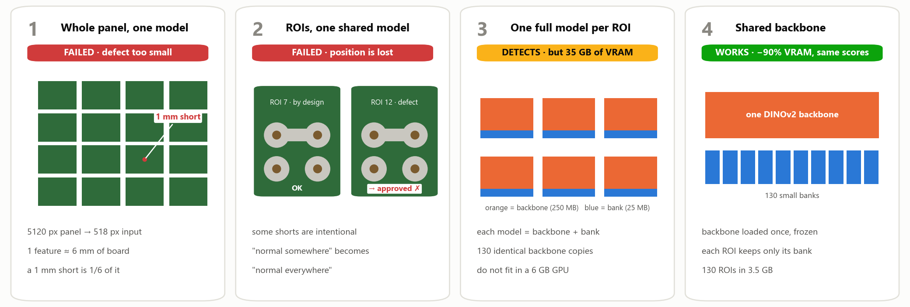<br>
  <i>The four versions the project went through, in order. Section 2.3 tells each one.</i>
</p>

If you have five minutes, read the abstract, look at the figure above, the animation at the start of Attempt 4 and the table at the top of Section 3. If you have twenty, Sections 2.3 and 3.5 are the interesting parts.

---

### Resumo

Conferir solda de placa eletrônica no olho é um trabalho cansativo, e a atenção cai ao longo do turno. Os defeitos que importam (curto, falta de solda, excesso) são raros e cada um aparece de um jeito, então montar um dataset rotulado para treinar um detector supervisionado não é viável na linha. Neste trabalho usei o PatchCore, que aprende só com peça boa, para inspecionar painéis com mais de 32 placas de fonte. Cheguei na solução depois de três tentativas. Um modelo para o painel inteiro não enxergava um defeito de 1 mm. Um modelo único para todos os recortes (ROIs) falhava porque, nessas placas, alguns curtos e faltas de solda são propositais. Um modelo por ROI resolveu a detecção, mas cada modelo carregava a sua própria cópia do backbone, e 130 ROIs não cabiam na GPU. Como o PatchCore nunca treina o backbone, essas 130 cópias são idênticas: passei a carregar um único DINOv2 congelado e cada ROI guarda só o seu banco de memória. As notas ficam praticamente iguais às do anomalib (diferença de 0,001%) e a VRAM para 130 ROIs cai de 35,0 GB (projetado) para 3,5 GB (medido) numa GPU de notebook de 6 GB, 90% a menos. Também rodei o pipeline nas quatro categorias de PCB do dataset público VisA. Ele reproduziu a perda de sinal da tentativa do painel inteiro, mostrou que guardar só 1% dos vetores não piora o resultado e trouxe uma surpresa: nessas placas a configuração de produção (bloco 8 do DINOv2 ViT-B) foi a mais fraca das testadas, e o bloco 2 da mesma rede chegou a AUROC de imagem de 0,933 contra 0,787. A camada, portanto, precisa ser validada para cada produto.

### Abstract

Checking solder joints by eye is tiring work, and attention drops during a shift. The defects that matter (shorts, missing or excess solder) are rare and each one looks different, so a labeled dataset for a supervised detector is not realistic on the line. I used PatchCore, which learns from good parts only, to inspect panels with more than 32 power-supply boards. The final design came after three attempts. A single model for the whole panel could not see a 1 mm defect. A single model for all regions of interest (ROIs) failed because, on these boards, some shorts and missing joints are intentional. One model per ROI solved detection, but each model carried its own copy of the backbone, and 130 ROIs did not fit in the GPU. PatchCore never trains the backbone, so those 130 copies are identical: I now load one frozen DINOv2 and each ROI keeps only its memory bank. Scores stay practically the same as anomalib's (0.001% difference) and VRAM for 130 ROIs goes from 35.0 GB (projected) to 3.5 GB (measured) on a 6 GB laptop GPU, 90% less. I also ran the pipeline on the four PCB categories of the public VisA dataset. It reproduced the loss of signal of the whole-panel attempt, showed that keeping only 1% of the vectors does not hurt, and brought a surprise: on those boards the production setting (block 8 of DINOv2 ViT-B) was the weakest one tested, and block 2 of the same network reached an image AUROC of 0.933 against 0.787. The layer has to be validated per product.

---

## Table of contents

1. [Introduction](#1-introduction) · [related work](#14-related-work)
2. [Modeling](#2-modeling)
   - [2.1 Data](#21-data)
   - [2.2 How PatchCore works](#22-how-patchcore-works)
   - [2.3 Four attempts](#23-four-attempts)
   - [2.4 Final architecture](#24-final-architecture)
   - [2.5 Parameters and why I picked them](#25-parameters-and-why-i-picked-them)
   - [2.6 A threshold without defective samples](#26-a-threshold-without-defective-samples)
3. [Results](#3-results)
4. [Conclusions](#4-conclusions)
5. [FAQ](#5-faq)
6. [How to run](#6-how-to-run)
7. [Repository structure](#7-repository-structure)
8. [References](#8-references)

---

## 1. Introduction

### 1.1 The problem

The boards come out of wave soldering held together in a **panel**, one big board with more than 32 small power supplies. Before the panel is cut, someone checks hundreds of solder joints looking for three kinds of defect:

| Defect | What it looks like |
|---|---|
| Short (bridge) | solder joining two pins that should be separate |
| Missing solder | a pin with no solder around it, with the copper ring showing |
| Excess solder / solder ball | a blob on the joint, or a loose ball of solder next to it |

It doesn't sound like much, but a 1 mm bridge is enough to fail the board at final test or, worse, in the customer's hands. And looking for it panel after panel, a whole shift long, wears anyone out.

<p align="center">
  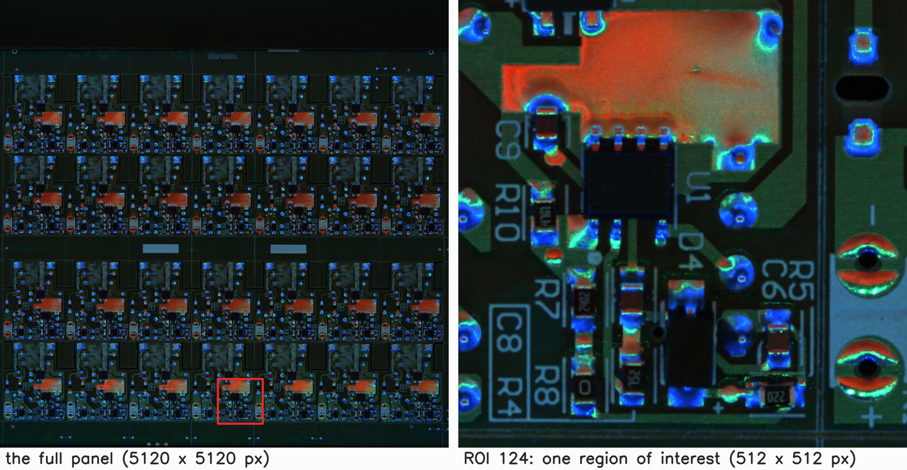<br>
  <i>Figure 1. A panel of Board D as the camera sees it (28 power supplies, 5120 × 5120 px) and a zoom on one region of interest. The blurred blocks are the logo and the product code, which cannot appear.</i>
</p>

### 1.2 Why unsupervised

The first question everybody asks is: why not train a YOLO? Because a supervised detector needs a lot of labeled examples of every defect type, and on a line that already works well, defects are rare. There are thousands of good joints for each bad one, and the bad ones are never the same. I would spend months collecting a decent dataset, and the next new defect would still be missing from it.

Anomaly detection turns the problem inside out. Instead of teaching the model what a defect looks like, I teach it what a good joint looks like, and it flags whatever does not match. Good parts are the one thing I have plenty of: the line makes them all day. I picked PatchCore [1] because it is the reference method on industrial benchmarks, it is simple to train (none of that long neural-network training over many epochs) and it gives back a heat map showing where the problem is.

### 1.3 Goal and contributions

What I wanted was a system that finds solder defects on real panels, runs on a modest GPU and can be retrained with photos of good parts only.

Along the way the work ended up bringing four things:

1. A pipeline with PatchCore and one model per ROI for solder inspection, together with the failed attempts that show why each region needs its own model.
2. One backbone shared by every ROI model. Instead of each model carrying its own copy of the network, they all use the same one, and each keeps only its own part (the memory bank). Scores stay the same and VRAM drops by about 90% with DINOv2 ViT-B.
3. Much smaller model files: each ROI model on disk went from 275 MB to 25 MB, and it loads in 18 ms.
4. A way of choosing the rejection threshold using only photos of good parts, without any defective sample.

### 1.4 Related work

PaDiM [9] and PatchCore [1] are two of the best-known methods for this kind of anomaly detection on industrial images. PatchCore keeps a "memory bank" with small pieces of the good images and compares each new image against it, and it became the reference on MVTec AD [7] and VisA [6], the two most used public datasets in this area.

AnomalyDINO [2] showed that DINOv2 [3], a network from Meta trained without labels, works very well for this kind of comparison, even with few good images. Reading that paper is what made me try DINOv2.

The closest work to mine that I found is Rolih et al. [10]. They split high-resolution images into pieces and train one model per piece, which is the same idea as one model per ROI. In their case one model runs at a time. In mine I needed all 130 models loaded together to inspect the panel without waiting, and memory went down because I shared the only part that is identical in all of them: the backbone.

Everything is built on anomalib [5], Intel's library for anomaly detection, and the part that computes the PatchCore score is anomalib's own, unchanged.

---

## 2. Modeling

### 2.1 Data

| Item | Value |
|---|---|
| Camera | 26 MP industrial camera, 5120 × 5120 px, fixed over the jig |
| Resolution on the board | about 22 px per millimetre |
| ROI size | 512 × 512 px, about 23 × 23 mm: one group of joints plus a bit of context |
| ROIs per panel | 110 to 120 today (132 in an earlier version) |
| Good training photos | 38 to 224 panels, depending on the board |
| Boards | 4 power-supply models, which I call Board A, B, C and D here (the photos in this README are from Board D) |

Camera, jig and lighting are fixed, so each ROI always shows the same joints from the same angle. Even so, the panel moves a little between one photo and the next (4 to 16 pixels), and that is already enough to cause trouble. That is why each photo is aligned to a reference photo before the ROIs are cropped.

The production photos cannot be published. To have results anyone can reproduce, I also used the four PCB categories of VisA [6], a public dataset, in Section [3.5](#35-public-pcbs-visa).

<p align="center">
  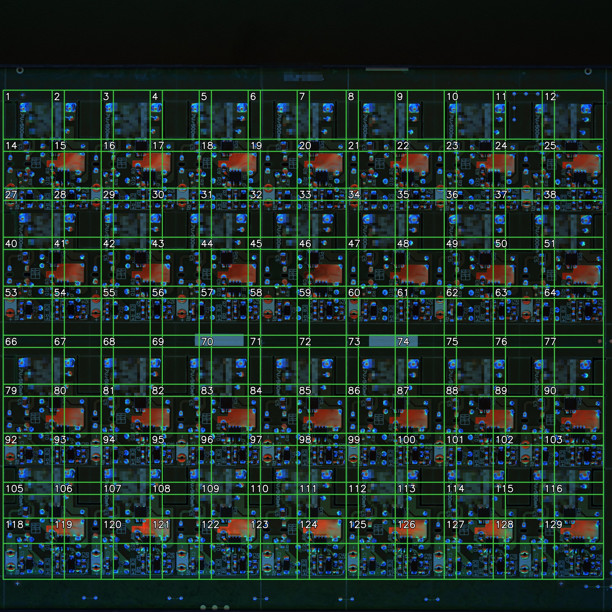<br>
  <i>Figure 2. The 120 ROIs of Board D, each one with its own model. They overlap a little on purpose, so that no joint is cut at the border between two ROIs.</i>
</p>

<p align="center">
  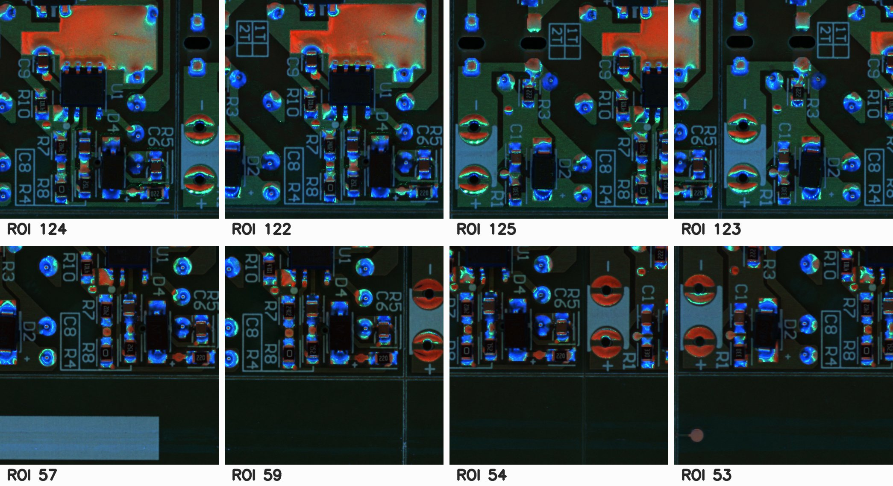<br>
  <i>Figure 3. Eight real ROIs of Board D. Even though the boards are identical, each region has different joints, components and text, and that is what each model learns as "normal".</i>
</p>

### 2.2 How PatchCore works

The easiest way I found to explain PatchCore is to think of a photo album of good solder, cut into little tiles.

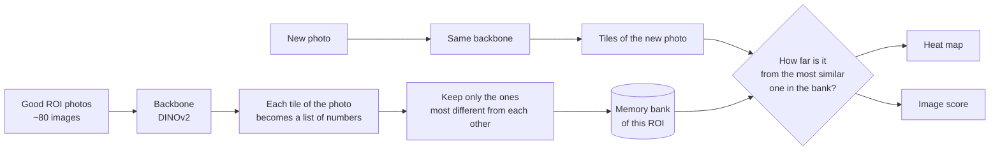

A network already trained on millions of images, the backbone, looks at each tile of the ROI and returns a list of numbers that describes that piece (texture, shape, brightness). The network is never trained again here; I only use it as a pair of eyes.

The lists from every tile of every good photo go into one place. Since most of them are practically the same (same joint, same light), PatchCore keeps only part of them, choosing the ones that are most different from each other. That is the so-called coreset. What is left is the memory bank of that ROI.

At inspection time, each tile of the new photo looks for the most similar one in the bank. If even the most similar is far away, the model has never seen anything like it. Those distances make the heat map, and the strangest tile sets the score of the image.

So "training" is just running the good photos through the network once and building the bank. It takes seconds per ROI.

### 2.3 Four attempts

This is the part I like telling the most, because every thing that went wrong left a decision that stayed in the project.

<details>
<summary><b>Project timeline</b> (from the history of the production system: 119 commits, March to October 2026)</summary>

| When | What happened |
|---|---|
| Mar 2026 | First prototype: training, ROI-size suggestion and multi-camera capture; I recorded the demo video |
| Apr 2026 | Running on the line server, plus a YOLO mode for other stations (out of scope here) |
| Jul 2026 | Project accepted as the VC MASTER final project |
| Sep 2026 | Tuning of the memory-bank size, VRAM measurement of the shared backbone and a suggestion sent to anomalib (64 commits that month) |
| Oct 2026 | Switched to DINOv2 after a side-by-side test on real panels; lean model files applied to the 110 production models, 4 968 MB down to 742 MB |
| Nov 2026 | This repository: clean version of the code, laptop measurements, VisA experiments |
</details>

#### Attempt 1: one model for the whole panel

The first idea was the obvious one: take the photo of the whole panel and hand it to PatchCore.

The catch is that the network works with 518 × 518 px images, so the 5120 × 5120 photo shrinks about 10 times on the way in. Each tile the network looks at ends up covering almost 6 mm of board. A 1 mm short becomes a small fraction of a tile, and its signal disappears among the good copper around it. The model simply had no way to see it.

<p align="center">
  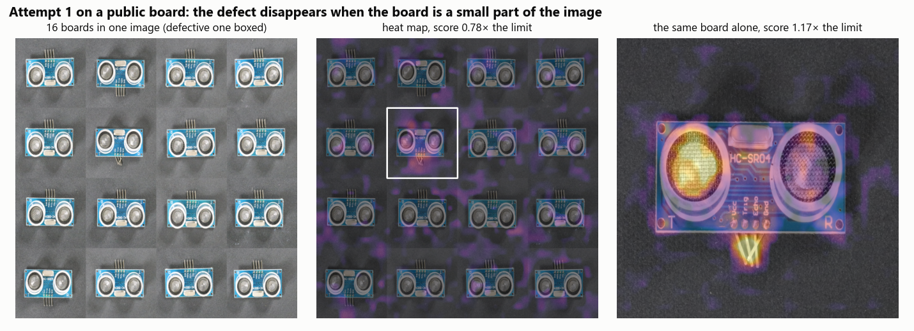<br>
  <i>Figure 4. The same thing reproduced on a public VisA board. Left: the defective board hidden among 16 good boards. Middle: the heat map of that "panel", where the defect barely shows. Right: the same board alone, where the defect is the hottest spot.</i>
</p>

The lesson was that the limit was resolution, and the way out was to zoom in: crop regions of interest.

#### Attempt 2: ROIs, but one model for all of them

With the ROIs drawn, I thought: what if I put every crop into one memory bank? One model instead of 130 would be much cheaper.

It didn't work, and for a reason I only understood after looking at the boards carefully. On these panels, some shorts and some missing joints are **intentional**. Certain pins are bridged on purpose by design, and some pads stay empty because they belong to a variant that is not assembled. With one bank, "normal" becomes anything any ROI has:

```
ROI 7   intentional short  → goes into the bank as normal
ROI 12  accidental short   → the most similar thing in the bank is the short from ROI 7
                           → looks normal → approved
```

PatchCore knows nothing about position. If something is normal in one place, it becomes normal everywhere. I went to check it in the numbers, and the banks of two different ROIs came out twice as far apart from each other as the photos of the same ROI. They really are different normals.

<p align="center">
  <b>[photo to add]</b> <code>assets/photos/attempt2_intentional_short.png</code><br>
  <i>Figure 5. Left: a ROI where the bridge is intentional. Right: a ROI where the same bridge is a defect. One shared model cannot tell them apart.</i>
</p>

That gave me the second lesson: each ROI needs its own model.

#### Attempt 3: one model per ROI

With one model per ROI, detection was good. The problem became memory. Each anomalib model comes with two parts, the backbone and the memory bank, and the heavy one is the backbone:

| Part of the model (DINOv2 ViT-B, 80 training photos) | Size in VRAM |
|---|---|
| Backbone | 250 MB |
| Memory bank | 25 MB |

130 ROIs means 130 copies of the same network, about 35 GB, on a 6 GB GPU. No way.

<p align="center">
  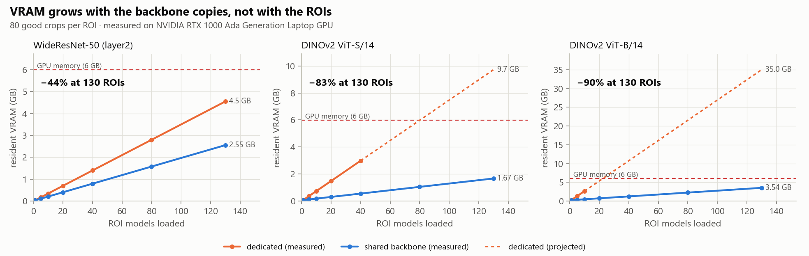<br>
  <i>Figure 6. VRAM in use as ROI models are loaded. Orange: one full model per ROI (dashed where it no longer fits and the value is estimated). Blue: shared backbone. Measured on an RTX 1000 Ada Laptop GPU, 6 GB.</i>
</p>

#### Attempt 4: one shared backbone, one bank per ROI

<p align="center">
  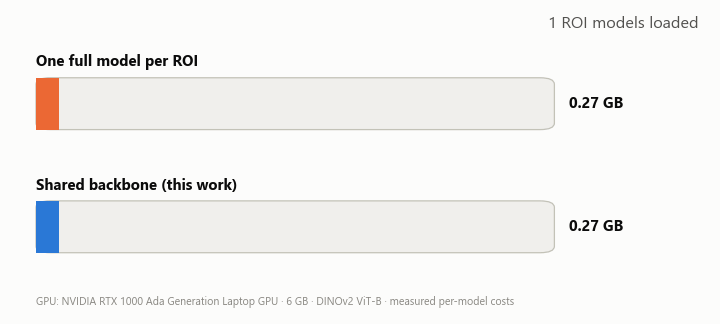<br>
  <i>The 130 ROI models of a panel being loaded one by one on a 6 GB GPU.</i>
</p>

It clicked when I went to look at how anomalib "trains" PatchCore. The backbone is never adjusted: it comes ready and is only used to look at the photos. In other words, those 130 copies were exactly the same, and the only thing that differed from one ROI model to the next was the memory bank.

Before changing anything, I checked it on the production system. I took two models trained on different photos: the banks were different, so were the thresholds, and the backbone weights in the two files were identical. In this repository [`scripts/check_equivalence.py`](scripts/check_equivalence.py) runs the same check (Section 3.1).

So I started loading the backbone only once, and every ROI model uses that same copy. The math is simple: with one full model per ROI, memory is 130 copies of the backbone plus 130 banks; with sharing, it is one copy of the backbone plus the 130 banks. The bigger the backbone compared to a bank, the more you save.

<p align="center">
  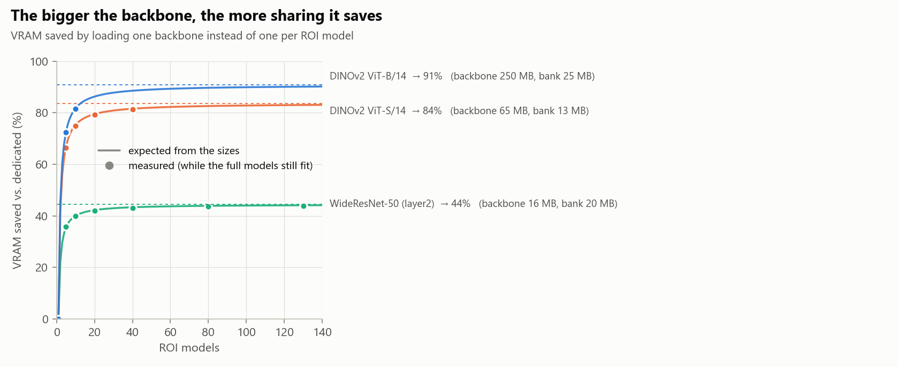<br>
  <i>Figure 7. How much VRAM sharing saves, as the number of ROI models grows. Lines: what the sizes predict. Dots: measured.</i>
</p>

With DINOv2 ViT-B the saving gets close to 90%. With WideResNet-50, which is much smaller, it stays around 44%. That also explains why, in the older versions of the system that still used WideResNet, I had only measured a 50 to 70% saving.

#### What else it took to work on the line

Sharing the backbone solved memory, but running it on the real line needed a few more changes:

| Change | The problem | What changed |
|---|---|---|
| Aligning the panel photo with a reference before cropping | the panel moves a few pixels between photos, and good ROIs were getting rejected | on 4 test ROIs, 3 false alarms went away and the defects were still rejected |
| Saving only the memory bank in the model file | anomalib saves the whole backbone inside every file; when I switched to DINO, the 110 models filled up the server's disk | each file went down to about 7 MB, and the 110 models went from 4 968 MB to 742 MB, with the same scores |
| Not building the backbone again when loading each model | anomalib built a whole backbone per model and then threw it away | loading each model went from 1 s to 0.03 s |
| Smoothing the heat map a faster way | that step was slow on the GPU | from 68 ms to 0.55 ms per ROI |
| Turning on a speed optimization of DINO | anomalib leaves it off by default | from 106 ms to 91 ms per ROI, same scores |

The heat-map smoothing even led to a conversation with the anomalib team: I opened [issue #3780](https://github.com/open-edge-platform/anomalib/issues/3780) suggesting the change. The maintainer asked for more tests and, on the newer PyTorch version they use today, the original step was already fast. I withdrew the suggestion. The gain is real here, where I use PyTorch 2.5.1, but not on recent versions.

#### Traps I found along the way

Sharing a backbone looks like a simple change. It wasn't. And the worst part is that the problems below show no error on screen; you only notice them by measuring:

- The way anomalib's own documentation suggests to reuse a backbone ends up keeping a hidden copy of it inside every model, about 265 MB extra per model. In practice nothing was being shared. I solved it by building the ROI model without a backbone and handing it the shared one only when it is used.
- The order of the layers in the config file matters. If it is reversed, anomalib swaps the labels under the hood and nothing warns you.
- anomalib's default holds out 20% of the good photos at random for validation. Those photos never get into the bank, and the threshold comes from about 5 random photos, changing with every training. I replaced it with another way of computing the threshold, described in Section 2.6.

### 2.4 Final architecture

Putting it all together, the system looks like this:

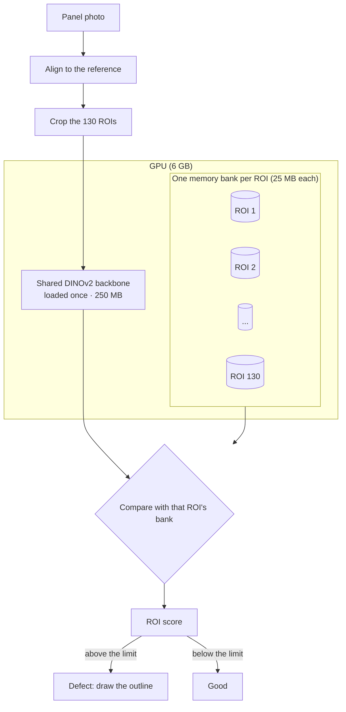

In the code this became two main parts: one that loads the backbone once and lends it to everybody ([`backbone.py`](src/pcbad/backbone.py)), and one that represents the model of each ROI, keeping only its memory bank and threshold ([`patchcore.py`](src/pcbad/patchcore.py)). The score is still computed by anomalib itself.

### 2.5 Parameters and why I picked them

Every number in the configuration has a story:

| Parameter | Value | Why |
|---|---|---|
| Backbone | DINOv2 ViT-B (base version) | on the same 17 production photos, the gap between the real short and the most "unusual" good ROI went from 11% with WideResNet-50 to 50% with DINOv2. At 11% there is almost no room to place the threshold. The cost is time: 19 to 91 ms per ROI. On VisA it went the other way, and I tell that story in Section [3.5](#35-public-pcbs-visa). |
| Layer | block 8 of 12 | a block in the middle of the network, which sees shape without losing local detail. The layer test on VisA (Section [3.5](#35-public-pcbs-visa)) made me rethink this choice. |
| ROI size and input size | 512 px ROI, 518 px input | DINOv2 works with 14 px tiles, so the input has to be a multiple of 14, and 518 is the closest to 512. The ROI is enlarged just a little and loses no resolution. Each tile covers about 0.6 mm of board, and a short is 1 mm or more. |
| How much to keep in the bank (coreset) | 10% of the vectors, going down slowly with more photos, never below 1% | keeping 50%, the 130 models would need 10.6 GB; with 10%, about 2 GB. The PatchCore paper itself uses 1% and gets the same result as the full bank. The way I set it, doubling the photos makes the bank grow 41%, not 100% (Figure 8). |
| Neighbors used in the score | 9 | it's the default of the paper and of anomalib. It worked well, so I left it, and the VisA test confirmed 9 is among the best values. |
| Threshold | computed from good photos only | explained in Section [2.6](#26-a-threshold-without-defective-samples) |
| Sensitivity margin | 1.15 | the final limit is the computed threshold plus 15%. It's a small extra so the station doesn't raise false alarms for nothing over a small change in light or position, and real defects still score above it. |
| Seed | 42 | the coreset choice starts from a random point. With the seed fixed, retraining on the same photos gives exactly the same threshold (22.082272 both times). With other seeds it moves about 5%. |
| Defect outline | half of the heat-map peak | that way a small defect gets a small outline and a big defect gets a big one. I picked yellow and magenta because they stay easy to tell apart for color-blind people. |

<p align="center">
  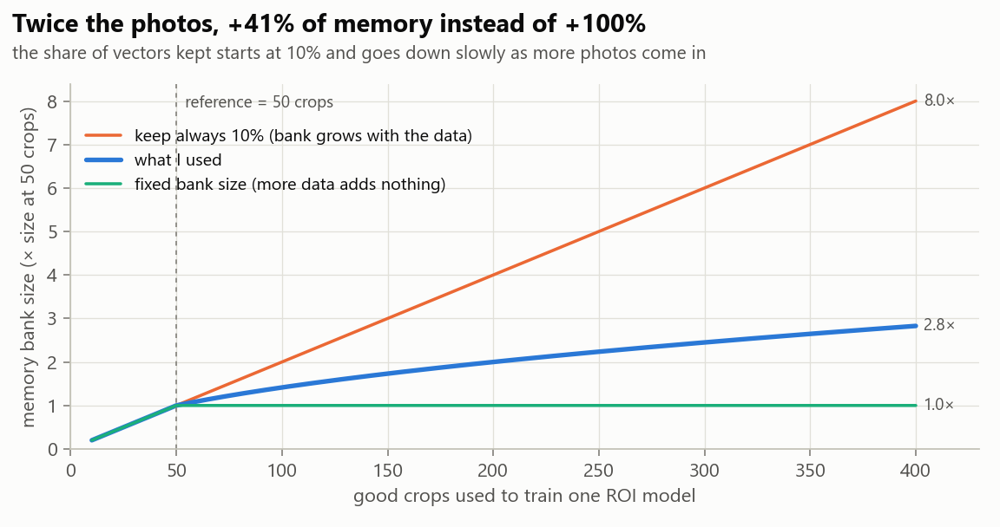<br>
  <i>Figure 8. Size of the memory bank as the number of training photos grows.</i>
</p>

And why not keep the whole bank? Because fifty photos of the same jig, under the same light, give almost identical tiles at each position, and most of a ROI is flat green solder mask. Even keeping 10%, the bank still has about 8 600 vectors. In the end, what really matters is the variety of the photos, much more than the size of the bank.

### 2.6 A threshold without defective samples

To set a rejection threshold you usually need defective examples. I have none at training time, so the threshold has to come from the good photos themselves.

At first I used anomalib's default, and that's how I found the random-split problem I mentioned above. I replaced it with this:

1. All good photos go into the memory bank.
2. Then each photo gets a score as if it were a new part, using the bank without the pieces that came from that photo (the technique is known as *leave-one-out*).
3. The threshold goes at the point that leaves 90% of those scores below it. That way, if one or two odd photos (say, a defect that slipped into the training set) score high, they don't pull the threshold up.
4. The 1.15 margin goes on top.

I was worried that this shortcut (removing the photo's pieces instead of training again without it) would not hold, so I compared it against real retraining on 78 production photos. It matched: the difference stayed between 0.1% and 4%. The comparison also showed why you can't score a photo with itself still in the bank: one odd photo scored 15.5 that way and 39.9 without it. Exactly the photo I wanted to find was being hidden.

On VisA this calibration did what it should on the good boards: with the 1.15 margin, false alarms on unseen good boards stayed between 0 and 7%. The price is letting more defects through. With the production setting it caught only 7 to 17% of the defective boards; without the margin it caught 30 to 41%, with 4 to 14% false alarms. The margin is exactly the knob that trades one for the other.

<p align="center">
  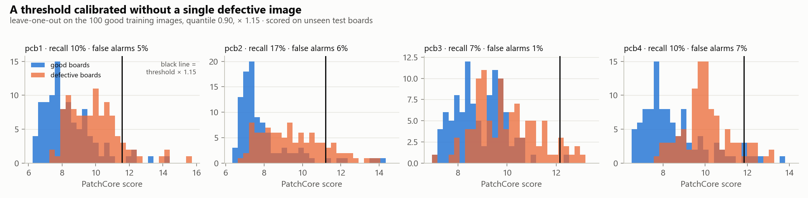<br>
  <i>Figure 9. VisA, DINOv2 ViT-B block 8: scores of unseen good and defective boards, and the line of the limit. The limit came from the good training photos only.</i>
</p>

---

## 3. Results

Before the details, a summary of what I measured:

| Question | Answer | Where |
|---|---|---|
| Does sharing the backbone change the scores? | practically not, 0.001% difference | [3.1](#31-sharing-the-backbone-does-not-change-the-result) |
| How much VRAM does it save? | 89.9% for 130 ROIs with DINOv2 ViT-B (35.0 GB to 3.54 GB) | [3.2](#32-memory) |
| How fast does a ROI model load? | 18 ms from a 25 MB file, against 1.5 s from 275 MB | [3.3](#33-load-time-and-file-size) |
| Is DINOv2 better than WideResNet? | on the production board yes, on VisA no | [3.4](#34-backbone-on-the-production-panels), [3.5](#35-public-pcbs-visa) |
| Which DINOv2 layer works best on VisA? | block 2 (0.933); block 8, used in production, was the worst of four | [3.5](#which-dinov2-layer) |
| Does keeping only 1% of the vectors hurt? | no, 0.812 against 0.789 with the full bank | [3.5](#the-other-parameters) |

Every memory and time number was measured on my laptop:

| | |
|---|---|
| GPU | NVIDIA RTX 1000 Ada Generation Laptop GPU, 6 GB |
| Software | PyTorch 2.5.1, anomalib 2.2.0, timm 1.0.24 |
| Bank size | that of 80 training photos per ROI |

### 3.1 Sharing the backbone does not change the result

This was the first thing I had to prove, otherwise nothing else would matter. I compared my model with the shared backbone against anomalib's original model, using the same memory bank:

| Check | DINOv2 ViT-B | WideResNet-50 |
|---|---|---|
| Difference in image score | 0.001% | 0 |
| Difference in heat map | negligible (0.002 on a 0 to 8 scale) | negligible (0.005 on a 0 to 16 scale) |
| Difference in backbone weights | none | none |

The tiny score difference comes from the DINO speed optimization I turned on, and the map difference comes from the faster smoothing. No board changes from approved to rejected because of it.

### 3.2 Memory

VRAM in use with 130 ROI models loaded:

| Backbone | Backbone size | Size of one bank | 130 ROIs, one full model each | 130 ROIs, shared backbone | Saving |
|---|---|---|---|---|---|
| WideResNet-50 | 15.8 MB | 19.8 MB | 4.55 GB (measured) | 2.55 GB | −43.8% |
| DINOv2 ViT-S | 64.8 MB | 12.7 MB | 9.72 GB (estimated) | 1.67 GB | −82.8% |
| DINOv2 ViT-B | 250.0 MB | 25.4 MB | 34.99 GB (estimated) | 3.54 GB | −89.9% |

"Estimated" means that configuration does not fit in the GPU and I had no way to run it. The value is the measured cost of one model times the number of models, and the points I could measure fall right on that line (Figure 6).

In practice, about 18 full DINOv2 ViT-B models fit on this 6 GB GPU. With the shared backbone about 190 fit, so any of the boards, with 110 to 120 ROIs, fits with room to spare.

The time per ROI doesn't change as models are added: about 90 ms with the shared backbone. Sharing only changes memory.

### 3.3 Load time and file size

How long it takes to load one ROI model from disk, with the shared backbone already loaded:

| Backbone | Standard anomalib file | File with the bank only |
|---|---|---|
| WideResNet-50 | 35.6 MB, 0.98 s | 19.8 MB, 0.009 s |
| DINOv2 ViT-S | 76.6 MB, 0.36 s | 12.7 MB, 0.006 s |
| DINOv2 ViT-B | 274.6 MB, 1.54 s | 25.4 MB, 0.018 s |

For a 130-ROI panel with ViT-B, that's the difference between waiting about 3 minutes and waiting 2 seconds for the station to be ready.

### 3.4 Backbone on the production panels

I ran this test earlier, on the production server, and it is what made me switch to DINOv2: one board, 17 photos, one real short.

| | WideResNet-50 | DINOv2 ViT-B |
|---|---|---|
| Score of the real short | 1.027 | 1.356 |
| Highest score among good ROIs | 0.924 | 0.906 |
| Gap between the short and the worst good ROI | 11% | 50% |
| Time per ROI | 19 ms | 91 ms |

With WideResNet the short scored only 11% above the worst good ROI, so any small variation turned into a miss or a false alarm. With DINOv2 that gap went to 50%. Later I also tried ViT-S, the smaller DINOv2, on the 7 hardest ROIs of Board C: it was faster (41 ms per ROI) and detected about the same.

Looking back, this comparison was small: one board and one real short. And the VisA results right below don't agree with it. I come back to that in the conclusions.

### 3.5 Public PCBs (VisA)

Since I can't publish the production photos, I ran the same code on the four PCB categories of VisA [6]. I used 100 good training photos per category (close to the ~80 per ROI I use on the line) and about 200 test photos per category, half good and half defective. Each board was treated as a single region. Everything here comes from [`scripts/eval_visa.py`](scripts/eval_visa.py), which took about 2 hours on the laptop. Since I only used 100 training photos (the full dataset has about 900 per category), these numbers are meant for comparing settings with each other, not with results published by other works.

The main metric here is AUROC, which goes from 0.5 (guessing) to 1.0 (perfect) and measures how well the model separates good boards from defective ones.

<p align="center">
  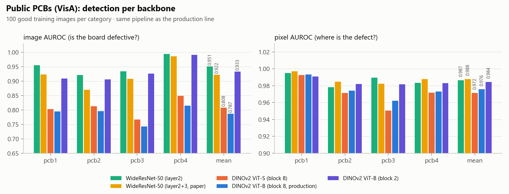<br>
  <i>Figure 10. Image AUROC (is the board defective?) and pixel AUROC (where is the defect?) per backbone on VisA.</i>
</p>

| Setting | Image AUROC (mean of 4) | Pixel AUROC | Defects caught at 1.15 | False alarms at 1.15 |
|---|---|---|---|---|
| WideResNet-50 | 0.951 | 0.987 | 54–91% | 1–4% |
| WideResNet-50, original paper setting | 0.922 | 0.988 | 32–94% | 0–6% |
| DINOv2 ViT-S, block 8 | 0.808 | 0.972 | 8–23% | 0–7% |
| DINOv2 ViT-B, block 8 (production setting) | 0.787 | 0.976 | 7–17% | 1–7% |
| DINOv2 ViT-B, block 8, with cosine distance | 0.891 | 0.985 | 21–49% | 1–5% |
| DINOv2 ViT-B, block 2 | 0.933 | 0.984 | 30–65% | 0–1% |

I have to admit this result caught me by surprise. On these boards the production setting was the weakest at telling whether a board has a defect, and WideResNet-50 was the best. For showing where the defect is (pixel AUROC), they all came out similar, between 0.97 and 0.99.

My first suspicion was a mistake on my side, so I went to check how the DINO features were being extracted. Everything was right. What helped was changing the way the distance between pieces is measured to a cosine distance, as AnomalyDINO [2] does: that alone took block 8 from 0.787 to 0.891.

<p align="center">
  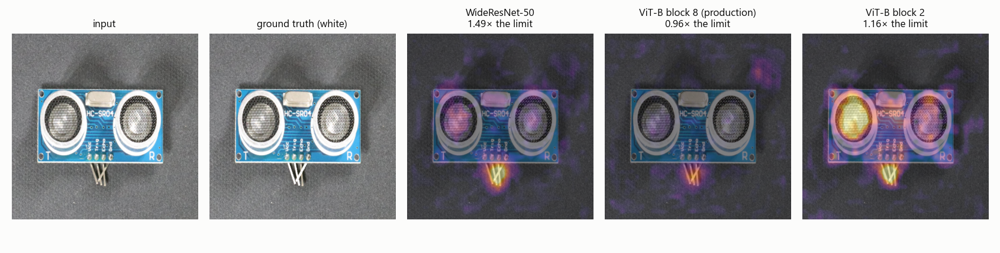<br>
  <i>Figure 11. The same defective board seen by each backbone. The number below is the score divided by the limit (1.00 or more is rejected).</i>
</p>

So why doesn't this agree with the production test in Section 3.4, where DINOv2 gave the bigger gap? The two tests don't look at the same kind of defect. VisA has missing parts, scratches and melted components on small modules (sensors and chargers) photographed on a flat background, while the line has solder joints under fixed lighting. And the production test was small. My reading is that the backbone has to be validated per product, which is why in the code it's just a configuration option.

#### Which DINOv2 layer

DINOv2 has 12 blocks, and the features can come from any of them. I tested four:

<p align="center">
  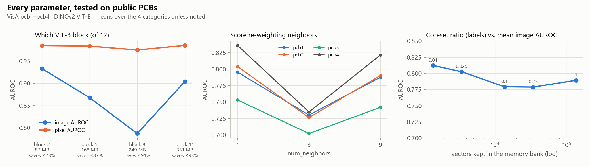<br>
  <i>Figure 12. Left: AUROC by the DINOv2 block the features come from, with the backbone size in each case. Middle: number of neighbors used in the score. Right: how much of the bank is kept against AUROC.</i>
</p>

| DINOv2 ViT-B block | Image AUROC | Pixel AUROC | Backbone size | Max VRAM saving |
|---|---|---|---|---|
| 2 | 0.933 | 0.984 | 87 MB | 78% |
| 5 | 0.868 | 0.983 | 168 MB | 87% |
| 8 (production) | 0.787 | 0.975 | 249 MB | 91% |
| 11 | 0.904 | 0.985 | 331 MB | 93% |

Block 8, the one I use in production, came out right at the bottom. Before believing it, I wanted to be sure the gap between block 2 and block 8 wasn't luck, so I ran a simple statistical test (bootstrap, with [`scripts/bootstrap_ci.py`](scripts/bootstrap_ci.py)). Block 2's advantage held in all four categories, with a safe margin. Training block 2 again from scratch moved the result by less than 0.01.

A block closer to the start of the network also makes the backbone smaller, so block 2 would be faster and use less VRAM, even if sharing saves a bit less (78% instead of 91%). I haven't tested block 2 on the solder joints yet, but it's the first thing I want to try on the line.

#### The other parameters

- Neighbors used in the score: 1 and 9 give almost the same result, and 3 was worse in all four categories, which I can't explain. I kept 9.
- Bank size: keeping only 1% of the vectors gave 0.812, and the full bank (100 times bigger) gave 0.789. On these boards, keeping less didn't hurt at all, just as the PatchCore paper promises.

#### The first two attempts, on public data

<p align="center">
  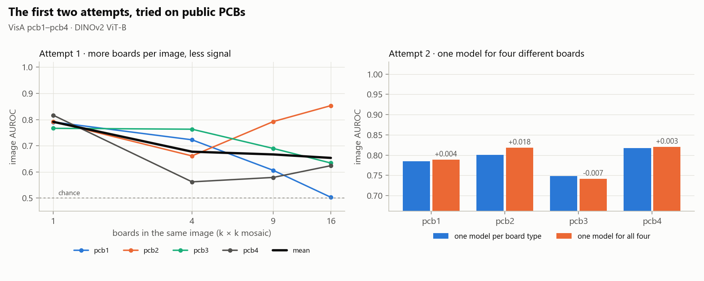<br>
  <i>Figure 13. Left: each test board placed among other good boards, to imitate a panel. Right: one model trained on the four board types together against one model per type.</i>
</p>

To imitate Attempt 1, I placed each board among other good boards (4, 9 and 16 boards per image) and trained and tested that way. Mean AUROC fell from 0.791 with the board alone to 0.677, 0.667 and 0.654. On pcb1 it reached 0.503, which is the same as guessing. pcb2 went the other way, and I still don't have an explanation for it.

For Attempt 2, I trained one model on the four board types together, and the result barely changed. That looked strange at first, but it fits what I told in Section 2.3: a single model only breaks when the same thing is normal in one place and a defect in another, like the intentional shorts on the line. VisA has no such case, so this test had no way of reproducing that failure.

#### Examples

<p align="center">
  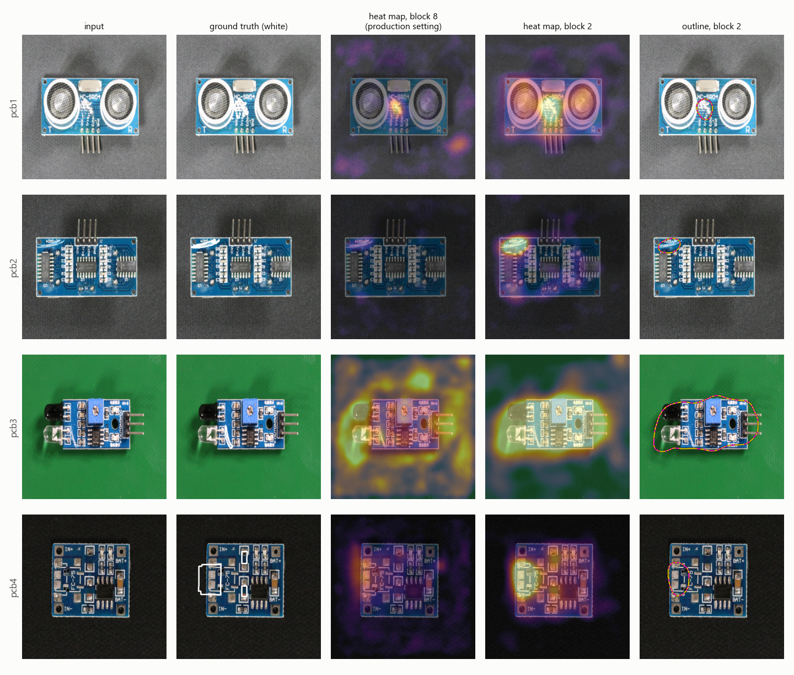<br>
  <i>Figure 14. One defective board per category: the photo, the defect marked in the ground truth, the heat map from block 8 (production), the one from block 2, and the outline drawn from block 2.</i>
</p>

<p align="center">
  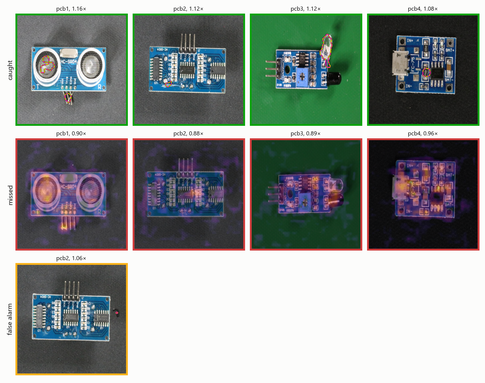<br>
  <i>Figure 15. With block 2 and margin 1.15: defective boards the system caught (yellow and magenta outline), defective boards that got through (heat map) and good boards it rejected. The number is the score divided by the limit. The only false alarm across the four categories was a tiny speck on the background, outside the board: the same "flags what is new, not what matters" that happens with scratches on the line.</i>
</p>

### 3.6 On the production line

These were measured on the production server, before this repository existed. The biggest one applies a solder filter (more about it in the next steps) to every old rejection that still had its original photo: 163 ROIs from the three boards, each evaluated again by the current model.

| Board | Rejected at the time | Pass with today's model | Dropped by the solder filter | Still rejected |
|---|---|---|---|---|
| A | 64 | 32 | 0 | 32 |
| B | 45 | 0 | 25 | 20 |
| C | 54 | 0 | 40 | 14 |

I checked the 65 dropped ones one by one: smooth solder mask, labels, mounting holes, none of them on a joint. The known shorts were still rejected. On one job of Board C, the rejections went from 11 (1 short and 10 scratches) to 3. And half of Board A's old rejections already pass with today's model, before any filter.

On the 7 hardest ROIs of Board C, with simulated defects, DINOv2 ViT-S caught 13 of 20 missing joints and 3 of 20 solder balls. Solder balls are small, and with the 1.15 margin the model lets most of them through.

What is still missing is a test set from the line with the defects marked, to measure how many defects the system catches and how many false alarms it gives on each board, as I did for VisA in Section 3.5.

---

## 4. Conclusions

PatchCore with one model per ROI finds solder defects using good panels only, and that is exactly what makes it usable on a line where defects are rare. Looking back, the attempts that failed taught me the most. The whole-panel model showed that resolution comes before everything else. The single shared model showed that position matters, at least on boards with intentional shorts and empty pads: each ROI needs its own idea of normal.

The main contribution came when I realized that this per-ROI design was spending almost all of its memory on identical copies of the same network. Sharing one backbone and keeping only the memory banks per ROI:

- the scores stay practically the same as anomalib's;
- VRAM goes down 90% with DINOv2 ViT-B, from 35 GB to 3.5 GB for 130 ROIs, which in practice is the difference between not running and running on a 6 GB laptop GPU;
- each model becomes a 25 MB file that loads in 18 ms.

And the bigger the backbone, the bigger the saving: about 44% with WideResNet-50 and about 90% with DINOv2 ViT-B.

The VisA test was the most useful surprise of the whole work. On those boards the production setting (DINOv2 ViT-B at block 8) was the weakest of the ones I tried, and block 2 of the same network or WideResNet-50 told defective boards from good ones much better. Just changing the way the distance is measured already took block 8 from 0.787 to 0.891. On the solder joints of the line DINOv2 had given the bigger gap, but that comparison used one board and one real short. I come out of this with two certainties: backbone and layer have to be checked on each product, and the architecture makes that check cheap, because both are just configuration options and the VRAM saving holds for any of them.

#### Limitations

- PatchCore flags what is new, and that is not always what matters. To it, a scratch or a speck of dust is as strange as a short: in one production job, 10 of the 11 rejected ROIs were scratches and only 1 was a real short.
- It depends on a fixed camera and jig. If the panel moves the photo has to be aligned, and if the light or the camera change it has to be trained again.
- The configurations with one full model per ROI that don't fit in the GPU were estimated, not measured. The points I could measure match the estimate, but the biggest values are extrapolations.
- The training photos need checking: a defective panel that slips into training teaches the model that its defect is normal.
- I still don't have a test set from the line with the defects marked, so production detection is shown through the comparison in Section 3.4 and the re-evaluated rejections in Section 3.6.

#### Next steps

- Test DINOv2 block 2, cosine distance and WideResNet-50 on the solder joints, with a test set from the line.
- Bring into this repository the solder filter that already runs in production and was left out of scope here. It ignores anomalies that fall far from any solder: on 163 old rejections from three boards it dropped 65, each checked by hand as scratches and stains, and the known shorts were still rejected.
- Make the memory banks even smaller to bring VRAM further down.
- Process all ROIs of a panel at once, instead of one by one, so a panel comes out faster.

---

## 5. FAQ

<details>
<summary><b>Why not YOLO or another supervised detector?</b></summary>

Because I would need hundreds of labeled examples of every defect type, and here defects are rare and keep changing. PatchCore needs good panels only, and it still catches defects nobody had listed before. The downside is that it flags anything new, scratches included (see Limitations).
</details>

<details>
<summary><b>Does sharing the backbone change the detection?</b></summary>

No. The backbone is the same in every model, and the scores match the original anomalib with a 0.001% difference (Section 3.1).
</details>

<details>
<summary><b>Why DINOv2 and not the WideResNet-50 from the paper?</b></summary>

On the real panels DINOv2 moved the gap between a real short and the worst good ROI from 11% to 50%, and the threshold stopped sitting on a knife's edge. A bigger backbone also makes sharing pay off more, about 90% instead of 44%. On VisA, though, WideResNet did better (Section 3.5), so this is a choice to check on each product. In the code the backbone is just a configuration option.
</details>

<details>
<summary><b>How many good photos does a new ROI need?</b></summary>

The code refuses fewer than 5. On the line, 50 to 80 panels per ROI worked well. Variety counts more than quantity: 50 different panels are worth more than 200 photos of the same panel, because the model needs to learn how good panels vary from one to another.
</details>

<details>
<summary><b>What if a defective panel gets into the training set?</b></summary>

The model learns that defect as normal for that ROI and will pass it. The way the threshold is computed keeps one or two bad photos from raising the limit for every other defect, but it doesn't unlearn the one that got in. It's always worth taking a look at the training photos.
</details>

<details>
<summary><b>Does it need a GPU?</b></summary>

No, it runs on the CPU too, just much slower. The whole point of sharing the backbone is that a 6 GB laptop GPU can handle a full panel.
</details>

<details>
<summary><b>Glossary</b></summary>

| Term | Meaning here |
|---|---|
| ROI | region of interest, a 512 × 512 px crop of the panel around a group of joints |
| Backbone | network already trained that turns an image into numbers; here it is never trained again |
| Memory bank | the pieces of good photos each ROI model keeps for comparison |
| Coreset | the choice of which pieces to keep in the bank, picking the most different ones |
| Score | how far the strangest piece of the photo is from the most similar good piece; 1.0 or more (after dividing by the limit) is a defect |
| Threshold, margin | the computed limit for the score, and the 15% extra on top of it |
| AUROC | metric from 0.5 (guessing) to 1.0 (perfect) that measures how well the model separates good boards from defective ones |
| VRAM | memory of the graphics card (GPU) |
</details>

---

## 6. How to run

**1. Environment** (Python 3.10, NVIDIA GPU recommended)

```bash
python -m venv .venv
.venv\Scripts\activate            # Linux/macOS: source .venv/bin/activate
pip install -r requirements.txt --extra-index-url https://download.pytorch.org/whl/cu121
```

The DINOv2 weights (about 350 MB) download by themselves the first time.

**2. Quick test on a public PCB** (VisA)

If you just want to see the system working, this is the shortest path:

```bash
mkdir -p data/visa && cd data/visa
curl -LO https://amazon-visual-anomaly.s3.us-west-2.amazonaws.com/VisA_20220922.tar     # 1.9 GB
mkdir VisA && tar -xf VisA_20220922.tar -C VisA --wildcards "pcb*/*"
curl -LO https://raw.githubusercontent.com/amazon-science/spot-diff/main/split_csv/1cls.csv
cd ../..

python scripts/prepare_visa_demo.py --visa data/visa/VisA --split data/visa/1cls.csv --category pcb1
python scripts/train.py --board data/visa_demo/pcb1 --out models/visa_pcb1
python scripts/infer.py --models models/visa_pcb1 --images data/visa_demo/pcb1/test --out outputs/visa_pcb1
```

**3. Reproducing the numbers in this README**

| Command | What it produces | Time on my laptop |
|---|---|---|
| `python scripts/check_equivalence.py --backbone dinov2_vitb14` | Section 3.1 | under 1 min |
| `python scripts/benchmark_vram.py` | Sections 3.2 and 3.3, Figures 6 and 7 | about 15 min |
| `python scripts/eval_visa.py --visa data/visa/VisA --split data/visa/1cls.csv` | Section 3.5 | about 3 h |
| `python scripts/make_figures.py` | Figures 6 to 8, overview figure, VRAM animation | seconds |
| `python scripts/visa_layer_examples.py --visa data/visa/VisA --split data/visa/1cls.csv` | block-2 heat maps for Figure 14 | about 10 min |
| `python scripts/bootstrap_ci.py --visa data/visa/VisA --split data/visa/1cls.csv` | statistical test in Section 3.5 | under 1 min |
| `python scripts/make_visa_figures.py --visa data/visa/VisA --split data/visa/1cls.csv` | VisA charts | under 1 min |
| `python scripts/make_visa_photo_figures.py --visa data/visa/VisA --split data/visa/1cls.csv` | Figures 4, 11 and 15 | about 15 min |

**4. Web interface** (train, set the margin, inspect, see the VRAM in use)

I also made a simple interface for anyone who doesn't want to use the command line:

```bash
pip install gradio==5.9.1 pydantic==2.10.6
python app/demo.py          # http://127.0.0.1:7860
```

<p align="center">
  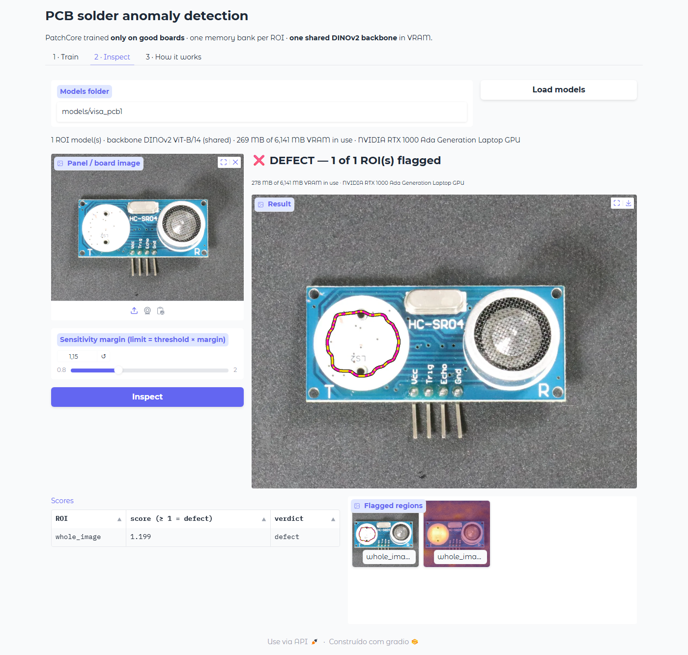<br>
  <i>Figure 16. The interface inspecting a VisA board: verdict, outline, heat map and VRAM in use.</i>
</p>

**5. Training on your own boards.** Organize the photos as in [data/README.md](data/README.md) and run:

```bash
python scripts/train.py --board data/board_a --out models/board_a
```

It trains one model per ROI, prints the threshold of each one and saves everything in the output folder.

**6. Inspecting panels**

```bash
python scripts/infer.py --models models/board_a --images data/board_a/test --out outputs/board_a --margin 1.15
```

For each panel you get an image with every ROI framed in green or red and the defects outlined, and a file with the score and verdict of each ROI.

<p align="center">
  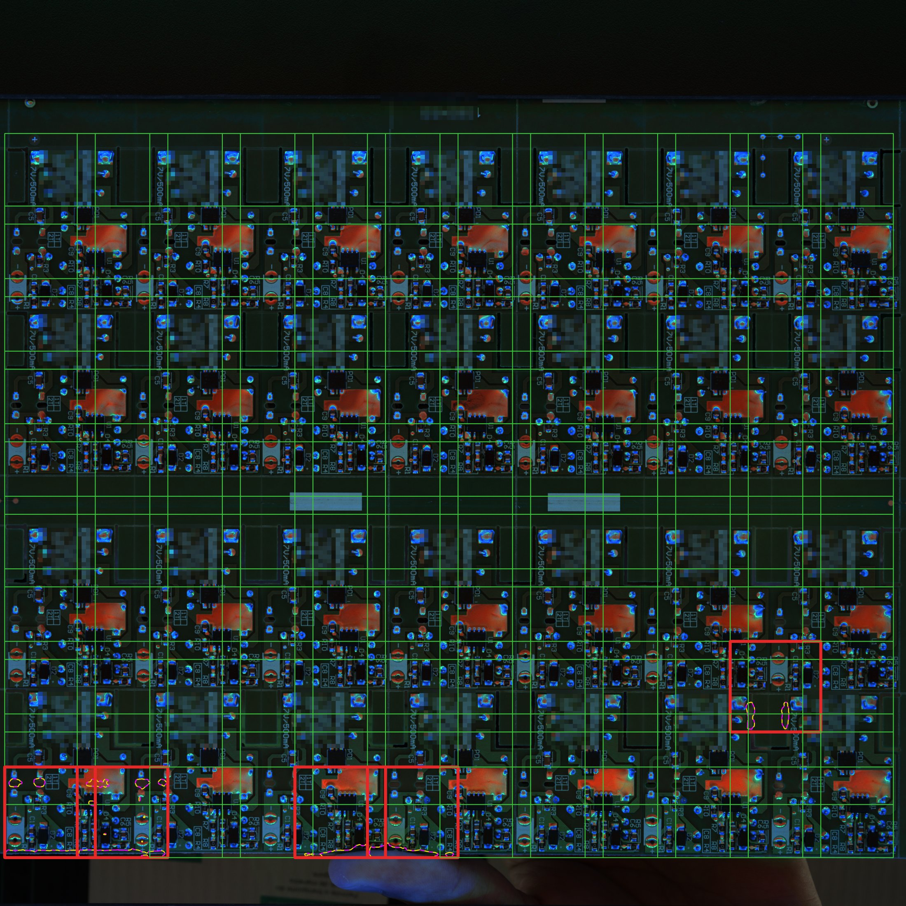<br>
  <i>Figure 17. A real inspection of Board D by the production system: approved ROIs in green and the 5 rejected ones in red, with the outline the system drew. Four of them are on the bottom edge, where the hand of whoever was holding the panel shows up in the photo. The model had never seen a hand there, so it flagged it, which is exactly the "flags what is new" from the limitations.</i>
</p>

---

## 7. Repository structure

```
├── README.md / README_pt.md
├── CITATION.cff
├── requirements.txt
├── src/pcbad/
│   ├── backbone.py            loads the backbone once and lends it to every model
│   ├── patchcore.py           the model of each ROI: memory bank and threshold
│   ├── coreset.py             how much to keep in the memory bank
│   ├── pipeline.py            trains a board and inspects an image
│   ├── data.py                photo layout and ROI cropping
│   └── visualize.py           defect outline and heat map
├── scripts/
│   ├── train.py               trains one model per ROI
│   ├── infer.py               inspects panels
│   ├── check_equivalence.py   checks that the shared backbone gives the same scores
│   ├── benchmark_vram.py      measures VRAM, load time and speed
│   ├── eval_visa.py           all the VisA experiments
│   ├── prepare_visa_demo.py   prepares a small VisA folder ready to train
│   ├── make_figures.py        memory charts, overview figure and animation
│   ├── make_visa_figures.py   VisA charts
│   ├── make_visa_photo_figures.py  figures with VisA images
│   ├── visa_layer_examples.py block-2 heat maps
│   ├── bootstrap_ci.py        statistical test block 2 vs block 8
│   ├── make_photo_figures.py  builds the real-photo figures from the production photos
│   └── hide_logo.py           hides the logo and product code on every board of a photo
├── app/demo.py                web interface
├── results/                   results written by the scripts
├── assets/figures/            charts and figures
├── assets/photos/             real panel photos (no logos)
└── data/README.md             how to organize your own photos
```

This repository is a clean version of the inspection core of a much bigger in-house system. The web platform, camera control, PLC integration and operator dashboard were left out.

---

## 8. References

1. K. Roth, L. Pemula, J. Zepeda, B. Schölkopf, T. Brox, P. Gehler. *Towards Total Recall in Industrial Anomaly Detection.* CVPR 2022. [arXiv:2106.08265](https://arxiv.org/abs/2106.08265)
2. S. Damm, M. Laszkiewicz, J. Lederer, A. Fischer. *AnomalyDINO: Boosting Patch-based Few-shot Anomaly Detection with DINOv2.* WACV 2025. [arXiv:2405.14529](https://arxiv.org/abs/2405.14529)
3. M. Oquab et al. *DINOv2: Learning Robust Visual Features without Supervision.* TMLR 2024. [arXiv:2304.07193](https://arxiv.org/abs/2304.07193)
4. T. Darcet, M. Oquab, J. Mairal, P. Bojanowski. *Vision Transformers Need Registers.* ICLR 2024. [arXiv:2309.16588](https://arxiv.org/abs/2309.16588)
5. S. Akcay et al. *Anomalib: A Deep Learning Library for Anomaly Detection.* ICIP 2022. [arXiv:2202.08341](https://arxiv.org/abs/2202.08341)
6. Y. Zou, J. Jeong, L. Pemula, D. Zhang, O. Dabeer. *SPot-the-Difference Self-Supervised Pre-training for Anomaly Detection and Segmentation (VisA).* ECCV 2022. [arXiv:2207.14315](https://arxiv.org/abs/2207.14315)
7. P. Bergmann, M. Fauser, D. Sattlegger, C. Steger. *MVTec AD – A Comprehensive Real-World Dataset for Unsupervised Anomaly Detection.* CVPR 2019.
8. O. Sener, S. Savarese. *Active Learning for Convolutional Neural Networks: A Core-Set Approach.* ICLR 2018. [arXiv:1708.00489](https://arxiv.org/abs/1708.00489)
9. T. Defard, A. Setkov, A. Loesch, R. Audigier. *PaDiM: a Patch Distribution Modeling Framework for Anomaly Detection and Localization.* ICPR Workshops 2020. [arXiv:2011.08785](https://arxiv.org/abs/2011.08785)
10. B. Rolih, D. Ameln, A. Vaidya, S. Akcay. *Divide and Conquer: High-Resolution Industrial Anomaly Detection via Memory Efficient Tiled Ensemble.* CVPR Workshops 2024. [arXiv:2403.04932](https://arxiv.org/abs/2403.04932)

### How to cite

```bibtex
@misc{fagundes2026pcbpatchcore,
  author       = {Andrei Edio Fagundes},
  title        = {Unsupervised Solder-Defect Detection on PCBs with PatchCore and a Shared Backbone},
  year         = {2026},
  howpublished = {Final project, Computer Vision Master (VC MASTER), ICA / PUC-Rio},
  note         = {Advisor: Manoela Kohler}
}
```

### Acknowledgments

Thanks to Prof. Manoela Kohler for the guidance, to the ICA / PUC-Rio team, and to the people on the production line and in test engineering who collected panels, marked defects and were patient with the false alarms of the first versions.

---

Matrícula: 242.100.031

Pontifícia Universidade Católica do Rio de Janeiro

Curso de Pós Graduação *Visão Computacional Master*
