# Detecção não supervisionada de defeitos de solda em PCB com PatchCore e backbone compartilhado

<p align="left">
  
  
  
  
  
  
</p>

#### Aluno: Andrei Edio Fagundes
#### Orientadora: [Manoela Kohler](https://www.linkedin.com/in/manoelakohler/)

---

Trabalho apresentado ao curso [VC MASTER](https://ica.puc-rio.ai/vc-master) como pré-requisito para conclusão de curso e obtenção de crédito na disciplina "Projetos de Sistemas Inteligentes de Apoio à Decisão".

- [Código](src/pcbad/)
- [English version of this README](README.md)
- Trabalhos relacionados:
  - [Towards Total Recall in Industrial Anomaly Detection (PatchCore)](https://arxiv.org/abs/2106.08265)
  - [AnomalyDINO: Boosting Patch-based Few-shot Anomaly Detection with DINOv2](https://arxiv.org/abs/2405.14529)
  - [DINOv2: Learning Robust Visual Features without Supervision](https://arxiv.org/abs/2304.07193)
  - [Anomalib: A Deep Learning Library for Anomaly Detection](https://arxiv.org/abs/2202.08341)
  - [SPot-the-Difference (dataset VisA, com 4 categorias de PCB)](https://arxiv.org/abs/2207.14315)
  - [Divide and Conquer: High-Resolution Industrial Anomaly Detection via Memory Efficient Tiled Ensemble](https://arxiv.org/abs/2403.04932)

---

<p align="center">
  <b>[foto a adicionar]</b> <code>assets/photos/hero.png</code><br>
  <i>Solda boa, a mesma solda com curto, o mapa de calor e o contorno que o sistema desenha.</i>
</p>

Esse projeto nasceu de um problema bem concreto da linha onde eu trabalho. No fim da montagem de fontes, cada painel tem mais de 32 plaquinhas, centenas de pontos de solda, e alguém precisa olhar um por um procurando curto, falta de solda ou excesso. Eu queria que uma câmera fizesse isso.

O caminho até funcionar foi bem menos direto do que eu imaginava. Tentei três jeitos que não deram certo antes de chegar no que está aqui, e este README conta essa história na ordem em que ela aconteceu. No final, cada região do painel tem o seu próprio modelo (de 110 a 120 por placa, e já foram 132), todos eles aprenderam só com placa boa, e todos dividem um único DINOv2 carregado uma vez na GPU. Foi esse último detalhe que fez o painel inteiro caber numa GPU de notebook de 6 GB.

| Modelos de ROI carregados | VRAM com um modelo completo por ROI | VRAM com o backbone compartilhado | Diferença de nota para o anomalib | Um modelo de ROI em disco |
|:---:|:---:|:---:|:---:|:---:|
| 130 | 35,0 GB (não cabe) | 3,5 GB | 0,001% | 25 MB (eram 275 MB) |

<p align="center">
  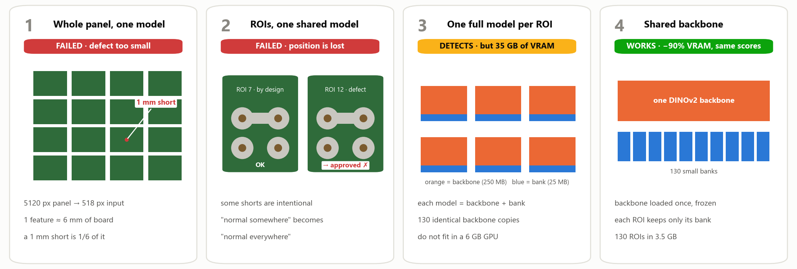<br>
  <i>As quatro versões pelas quais o projeto passou, na ordem. A seção 2.3 conta cada uma.</i>
</p>

Se você tem cinco minutos, leia o resumo, olhe a figura acima, a animação no começo da tentativa 4 e a tabela do começo da seção 3. Se tem vinte, a seção 2.3 e a 3.5 são as partes mais interessantes.

---

### Resumo

Conferir solda de placa eletrônica no olho é um trabalho cansativo, e a atenção cai ao longo do turno. Os defeitos que importam (curto, falta de solda, excesso) são raros e cada um aparece de um jeito, então montar um dataset rotulado para treinar um detector supervisionado não é viável na linha. Neste trabalho usei o PatchCore, que aprende só com peça boa, para inspecionar painéis com mais de 32 placas de fonte. Cheguei na solução depois de três tentativas. Um modelo para o painel inteiro não enxergava um defeito de 1 mm. Um modelo único para todos os recortes (ROIs) falhava porque, nessas placas, alguns curtos e faltas de solda são propositais. Um modelo por ROI resolveu a detecção, mas cada modelo carregava a sua própria cópia do backbone, e 130 ROIs não cabiam na GPU. Como o PatchCore nunca treina o backbone, essas 130 cópias são idênticas: passei a carregar um único DINOv2 congelado e cada ROI guarda só o seu banco de memória. As notas ficam praticamente iguais às do anomalib (diferença de 0,001%) e a VRAM para 130 ROIs cai de 35,0 GB (projetado) para 3,5 GB (medido) numa GPU de notebook de 6 GB, 90% a menos. Também rodei o pipeline nas quatro categorias de PCB do dataset público VisA. Ele reproduziu a perda de sinal da tentativa do painel inteiro, mostrou que guardar só 1% dos vetores não piora o resultado e trouxe uma surpresa: nessas placas a configuração de produção (bloco 8 do DINOv2 ViT-B) foi a mais fraca das testadas, e o bloco 2 da mesma rede chegou a AUROC de imagem de 0,933 contra 0,787. A camada, portanto, precisa ser validada para cada produto.

### Abstract

Checking solder joints by eye is tiring work, and attention drops during a shift. The defects that matter (shorts, missing or excess solder) are rare and each one looks different, so a labeled dataset for a supervised detector is not realistic on the line. I used PatchCore, which learns from good parts only, to inspect panels with more than 32 power-supply boards. The final design came after three attempts. A single model for the whole panel could not see a 1 mm defect. A single model for all regions of interest (ROIs) failed because, on these boards, some shorts and missing joints are intentional. One model per ROI solved detection, but each model carried its own copy of the backbone, and 130 ROIs did not fit in the GPU. PatchCore never trains the backbone, so those 130 copies are identical: I now load one frozen DINOv2 and each ROI keeps only its memory bank. Scores stay practically the same as anomalib's (0.001% difference) and VRAM for 130 ROIs goes from 35.0 GB (projected) to 3.5 GB (measured) on a 6 GB laptop GPU, 90% less. I also ran the pipeline on the four PCB categories of the public VisA dataset. It reproduced the loss of signal of the whole-panel attempt, showed that keeping only 1% of the vectors does not hurt, and brought a surprise: on those boards the production setting (block 8 of DINOv2 ViT-B) was the weakest one tested, and block 2 of the same network reached an image AUROC of 0.933 against 0.787. The layer has to be validated per product.

---

## Sumário

1. [Introdução](#1-introdução) · [trabalhos relacionados](#14-trabalhos-relacionados)
2. [Modelagem](#2-modelagem)
   - [2.1 Dados](#21-dados)
   - [2.2 Como o PatchCore funciona](#22-como-o-patchcore-funciona)
   - [2.3 Quatro tentativas](#23-quatro-tentativas)
   - [2.4 Arquitetura final](#24-arquitetura-final)
   - [2.5 Parâmetros e por que escolhi cada um](#25-parâmetros-e-por-que-escolhi-cada-um)
   - [2.6 Limiar sem nenhuma amostra com defeito](#26-limiar-sem-nenhuma-amostra-com-defeito)
3. [Resultados](#3-resultados)
4. [Conclusões](#4-conclusões)
5. [Perguntas frequentes](#5-perguntas-frequentes)
6. [Como executar](#6-como-executar)
7. [Estrutura do repositório](#7-estrutura-do-repositório)
8. [Referências](#8-referências)

---

## 1. Introdução

### 1.1 O problema

As placas saem da solda por onda presas num **painel**, uma placa grande com mais de 32 fontes pequenas. Antes de separar tudo, alguém confere centenas de pontos de solda atrás de três tipos de defeito:

| Defeito | Como aparece |
|---|---|
| Curto (ponte) | solda ligando dois terminais que deviam estar separados |
| Falta de solda | terminal sem solda em volta, com o anel de cobre aparecendo |
| Excesso de solda / bolinha | um acúmulo em cima do ponto, ou uma bolinha de solda solta perto dele |

Parece pouco, mas uma ponte de 1 mm já basta para a placa reprovar no teste final ou, pior, dar problema na mão do cliente. E procurar isso painel atrás de painel, o turno inteiro, cansa qualquer um.

<p align="center">
  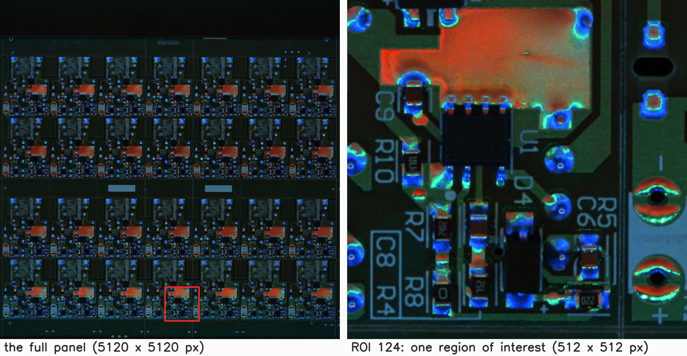<br>
  <i>Figura 1. Um painel da Placa D como a câmera vê (28 fontes, 5120 × 5120 px) e o zoom em uma região de interesse. Os blocos borrados são o logo e o código do produto, que não podem aparecer.</i>
</p>

### 1.2 Por que não supervisionado

A primeira pergunta que todo mundo faz é: por que não treinar um YOLO? Porque um detector supervisionado precisa de muito exemplo rotulado de cada tipo de defeito, e defeito, numa linha que já funciona bem, é raro. Tem milhares de soldas boas para cada ruim, e as ruins nunca são iguais. Eu levaria meses juntando um dataset decente, e o próximo defeito diferente continuaria de fora.

A detecção de anomalias vira o problema do avesso. Em vez de ensinar o que é defeito, eu ensino como é uma solda boa, e o modelo marca o que não se parece com ela. Peça boa é o que mais tem: a linha produz o dia inteiro. Escolhi o PatchCore [1] porque ele é a referência nos benchmarks industriais, é simples de treinar (não tem aquele treino longo de rede neural, com várias épocas) e ainda devolve um mapa de calor mostrando onde está o problema.

### 1.3 Objetivo e contribuições

O que eu queria era um sistema que achasse defeito de solda em painel de verdade, rodasse numa GPU modesta e pudesse ser retreinado só com foto de peça boa.

No caminho, o trabalho acabou trazendo quatro coisas:

1. Um pipeline com o PatchCore e um modelo por ROI para inspeção de solda, junto com as tentativas que falharam e que mostram por que cada região precisa do seu próprio modelo.
2. Um backbone compartilhado por todos os modelos de ROI. Em vez de cada modelo carregar a sua cópia da rede, todos usam a mesma, e cada um guarda só a sua parte própria (o banco de memória). A nota continua a mesma e a VRAM cai uns 90% com o DINOv2 ViT-B.
3. Arquivos de modelo bem menores: cada modelo de ROI em disco passou de 275 MB para 25 MB e carrega em 18 ms.
4. Um jeito de escolher o limiar de reprovação usando só fotos de peça boa, sem precisar de nenhuma amostra com defeito.

### 1.4 Trabalhos relacionados

O PaDiM [9] e o PatchCore [1] são dois dos métodos mais conhecidos para esse tipo de detecção de anomalias em imagem industrial. O PatchCore guarda um "banco de memória" com pedacinhos das imagens boas e compara cada imagem nova com ele, e virou a referência no MVTec AD [7] e no VisA [6], os dois datasets públicos mais usados nessa área.

O AnomalyDINO [2] mostrou que o DINOv2 [3], uma rede da Meta treinada sem rótulos, funciona muito bem nesse tipo de comparação, mesmo com poucas imagens boas. Foi lendo esse artigo que resolvi testar o DINOv2.

O trabalho mais parecido com o meu que encontrei é o de Rolih et al. [10]. Eles dividem imagens de alta resolução em pedaços e treinam um modelo para cada pedaço, que é a mesma ideia de um modelo por ROI. No caso deles, um modelo roda de cada vez. No meu, eu precisava dos 130 modelos carregados ao mesmo tempo para inspecionar o painel sem esperar, e a memória caiu porque compartilhei a única parte que é igual em todos: o backbone.

Tudo foi feito em cima do anomalib [5], a biblioteca da Intel para detecção de anomalias, e a parte que calcula a nota do PatchCore é a do próprio anomalib, sem alteração.

---

## 2. Modelagem

### 2.1 Dados

| Item | Valor |
|---|---|
| Câmera | câmera industrial de 26 MP, 5120 × 5120 px, fixa em cima da jiga |
| Resolução na placa | uns 22 px por milímetro |
| Tamanho da ROI | 512 × 512 px, uns 23 × 23 mm: um grupo de soldas e um pouco do entorno |
| ROIs por painel | de 110 a 120 hoje (já foram 132 numa versão anterior) |
| Fotos boas de treino | de 38 a 224 painéis, dependendo da placa |
| Placas | 4 modelos de fonte, que chamo aqui de Placa A, B, C e D (as fotos deste README são da Placa D) |

Câmera, jiga e iluminação são fixas, então cada ROI mostra sempre as mesmas soldas do mesmo ângulo. Mesmo assim o painel se mexe um pouquinho entre uma foto e outra (de 4 a 16 pixels), e isso já é suficiente para atrapalhar. Por isso cada foto é alinhada com uma foto de referência antes de recortar as ROIs.

As fotos de produção não podem ser publicadas. Para ter resultado que qualquer pessoa consiga reproduzir, usei também as quatro categorias de PCB do VisA [6], um dataset público, na seção [3.5](#35-pcbs-públicas-visa).

<p align="center">
  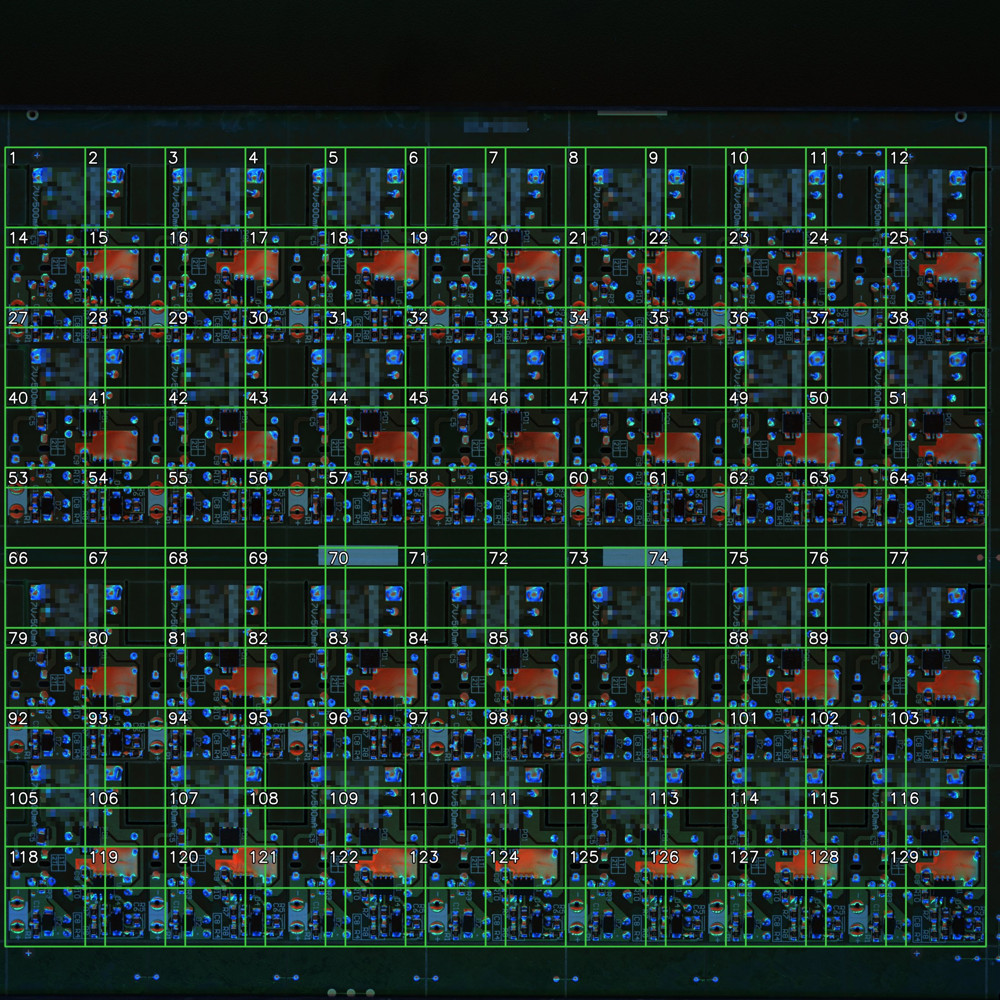<br>
  <i>Figura 2. As 120 ROIs da Placa D, cada uma com o seu próprio modelo. Elas se sobrepõem um pouco de propósito, para nenhuma solda ficar cortada na divisa entre duas ROIs.</i>
</p>

<p align="center">
  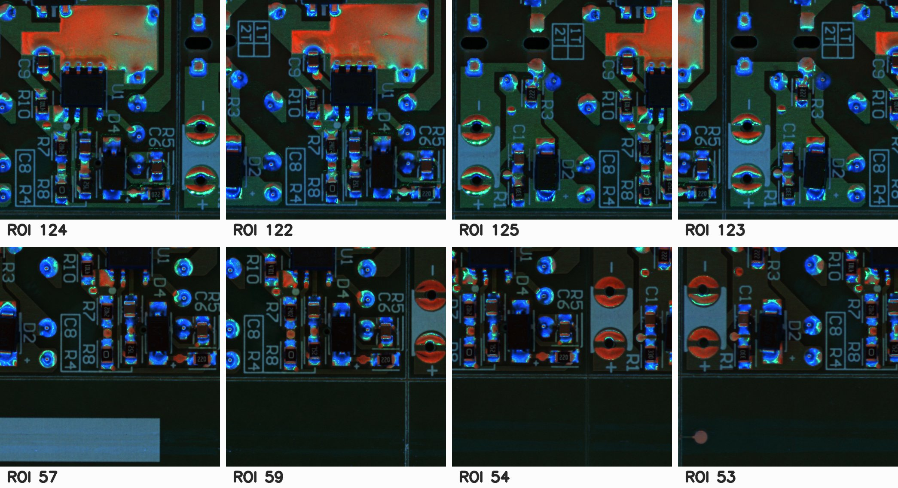<br>
  <i>Figura 3. Oito ROIs reais da Placa D. Mesmo sendo placas iguais, cada região tem soldas, componentes e textos diferentes, e é isso que cada modelo aprende como "normal".</i>
</p>

### 2.2 Como o PatchCore funciona

O jeito mais fácil que encontrei de explicar o PatchCore é pensar num álbum de fotos de solda boa, só que recortado em quadradinhos.

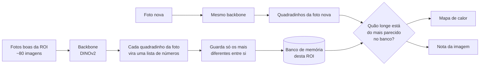

Uma rede já treinada em milhões de imagens, o backbone, olha cada quadradinho da ROI e devolve uma lista de números que descreve aquele pedaço (textura, forma, brilho). Essa rede não é treinada de novo em momento nenhum; eu só uso ela como "olhos".

As listas de todos os quadradinhos de todas as fotos boas vão para um mesmo lugar. Como a maioria é praticamente igual (mesma solda, mesma luz), o PatchCore guarda só uma parte delas, escolhendo as mais diferentes entre si. Isso é o tal do coreset. O que sobra é o banco de memória daquela ROI.

Na hora de inspecionar, cada quadradinho da foto nova procura o mais parecido no banco. Se até o mais parecido está longe, é porque o modelo nunca viu nada assim. Essas distâncias formam o mapa de calor, e o quadradinho mais estranho define a nota da imagem.

No fim das contas, "treinar" é só passar as fotos boas pela rede uma vez e montar o banco. Leva segundos por ROI.

### 2.3 Quatro tentativas

Essa é a parte que eu mais gosto de contar, porque cada coisa que deu errado deixou uma decisão que ficou no projeto.

<details>
<summary><b>Linha do tempo do projeto</b> (pelo histórico do sistema de produção: 119 commits, de março a outubro de 2026)</summary>

| Quando | O que aconteceu |
|---|---|
| mar/2026 | Primeiro protótipo: treino, sugestão de tamanho de ROI e captura com várias câmeras; gravei o vídeo de demonstração |
| abr/2026 | Sistema rodando no servidor da linha, mais um modo YOLO para outras estações (fora do escopo aqui) |
| jul/2026 | Projeto aceito como TCC do VC MASTER |
| set/2026 | Ajuste do tamanho do banco de memória, medição de VRAM do backbone compartilhado e uma sugestão enviada para o anomalib (64 commits no mês) |
| out/2026 | Troca para o DINOv2 depois do teste lado a lado em painel real; arquivos de modelo enxutos aplicados nos 110 modelos de produção, de 4 968 MB para 742 MB |
| nov/2026 | Este repositório: versão limpa do código, medições no notebook e experimentos no VisA |
</details>

#### Tentativa 1: um modelo para o painel inteiro

A primeira ideia foi a mais óbvia: pegar a foto do painel inteiro e entregar para o PatchCore.

Só que a rede trabalha com imagens de 518 × 518 px, então a foto de 5120 × 5120 encolhe umas 10 vezes antes de entrar. Cada quadradinho que a rede analisa passa a cobrir quase 6 mm de placa. Um curto de 1 mm vira uma fração pequena de um quadradinho, e o sinal dele some no meio do cobre bom em volta. O modelo simplesmente não tinha como ver.

<p align="center">
  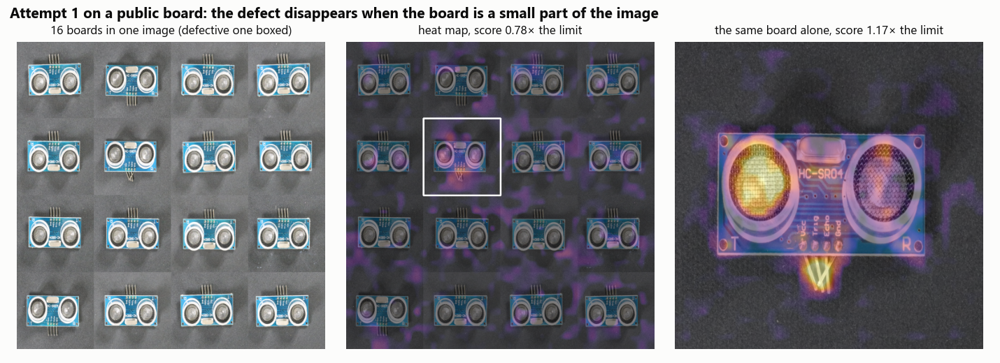<br>
  <i>Figura 4. A mesma coisa reproduzida numa placa pública do VisA. À esquerda, a placa com defeito escondida no meio de 16 placas boas; no centro, o mapa de calor desse "painel", em que o defeito quase não aparece; à direita, a mesma placa sozinha, em que o defeito é o ponto mais quente.</i>
</p>

A lição foi que o limite era resolução, e a saída foi dar zoom: recortar regiões de interesse.

#### Tentativa 2: ROIs, mas um modelo só para todas

Com as ROIs desenhadas, pensei: e se eu jogar todos os recortes num banco de memória só? Um modelo em vez de 130 seria bem mais barato.

Não funcionou, e por um motivo que eu só entendi olhando as placas com calma. Nesses painéis, alguns curtos e algumas faltas de solda são **propositais**. Certos terminais são ligados de propósito no projeto, e alguns pads ficam vazios porque são de uma variante que não é montada. Com um banco só, "normal" passa a ser tudo que qualquer ROI tem:

```
ROI 7   curto proposital  → entra no banco como normal
ROI 12  curto acidental   → o mais parecido no banco é o curto da ROI 7
                          → parece normal → aprova
```

O PatchCore não sabe nada de posição. Se uma coisa é normal num lugar, ela vira normal em todo lugar. Fui conferir nos números e os bancos de duas ROIs diferentes ficaram duas vezes mais distantes entre si do que as fotos de uma mesma ROI. São "normais" diferentes de verdade.

<p align="center">
  <b>[foto a adicionar]</b> <code>assets/photos/attempt2_intentional_short.png</code><br>
  <i>Figura 5. À esquerda, uma ROI em que a ponte é proposital. À direita, uma ROI em que a mesma ponte é defeito. Um modelo único não tem como separar as duas.</i>
</p>

Daí veio a segunda lição: cada ROI precisa do seu próprio modelo.

#### Tentativa 3: um modelo por ROI

Com um modelo por ROI a detecção ficou boa. O problema passou a ser memória. Cada modelo do anomalib vem com duas partes, o backbone e o banco de memória, e quem pesa é o backbone:

| Parte do modelo (DINOv2 ViT-B, 80 fotos de treino) | Tamanho na VRAM |
|---|---|
| Backbone | 250 MB |
| Banco de memória | 25 MB |

Com 130 ROIs são 130 cópias da mesma rede, uns 35 GB, numa GPU de 6 GB. Não tinha como.

<p align="center">
  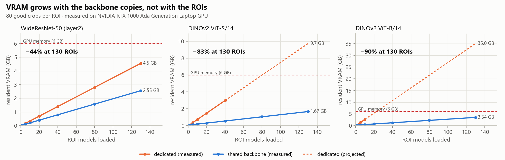<br>
  <i>Figura 6. VRAM ocupada conforme os modelos de ROI vão sendo carregados. Laranja: um modelo completo por ROI (tracejado onde não cabe mais e o valor é estimado). Azul: backbone compartilhado. Medido numa RTX 1000 Ada Laptop GPU de 6 GB.</i>
</p>

#### Tentativa 4: um backbone compartilhado e um banco por ROI

<p align="center">
  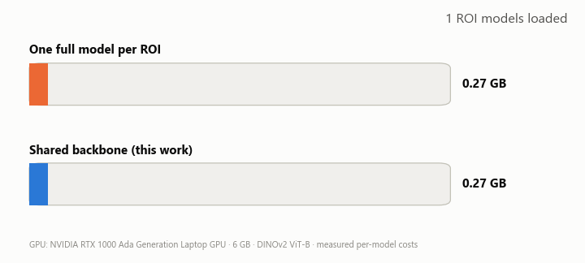<br>
  <i>Os 130 modelos de ROI de um painel sendo carregados um a um numa GPU de 6 GB.</i>
</p>

A ficha caiu quando fui olhar como o anomalib "treina" o PatchCore. O backbone nunca é ajustado: ele já vem pronto e só é usado para olhar as fotos. Ou seja, aquelas 130 cópias eram exatamente iguais, e a única coisa diferente de um modelo de ROI para outro era o banco de memória.

Antes de mudar qualquer coisa, conferi no sistema de produção. Peguei dois modelos treinados com fotos diferentes: os bancos eram diferentes, os limiares também, e os pesos do backbone nos dois arquivos eram idênticos. Neste repositório o [`scripts/check_equivalence.py`](scripts/check_equivalence.py) faz a mesma conferência (seção 3.1).

Então passei a carregar o backbone uma vez só, e todos os modelos de ROI usam o mesmo. A conta fica simples: com um modelo completo por ROI, a memória é 130 cópias do backbone mais 130 bancos; compartilhando, é uma cópia do backbone mais os 130 bancos. Quanto maior o backbone em relação ao banco, mais se economiza.

<p align="center">
  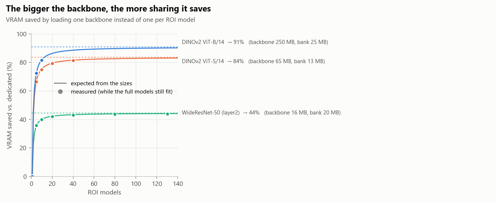<br>
  <i>Figura 7. Quanto de VRAM o compartilhamento economiza, conforme o número de modelos de ROI. Linhas: o esperado pelos tamanhos. Pontos: medido.</i>
</p>

Com o DINOv2 ViT-B a economia chega perto de 90%. Com a WideResNet-50, que é bem menor, fica em uns 44%. Isso também explica por que, nas versões antigas do sistema, ainda com WideResNet, eu só tinha medido de 50 a 70% de economia.

#### O que mais precisou para funcionar na linha

Compartilhar o backbone resolveu a memória, mas colocar isso para rodar na linha de verdade pediu mais alguns ajustes:

| Mudança | O problema | O que mudou |
|---|---|---|
| Alinhar a foto do painel com uma referência antes de recortar | o painel anda alguns pixels entre fotos, e ROIs boas chegavam a reprovar | em 4 ROIs de teste, 3 falsos defeitos sumiram e os defeitos continuaram reprovando |
| Salvar só o banco de memória no arquivo do modelo | o anomalib salva o backbone inteiro dentro de cada arquivo; quando troquei para o DINO, os 110 modelos encheram o disco do servidor | cada arquivo caiu para uns 7 MB, e os 110 modelos foram de 4 968 MB para 742 MB, com a mesma nota |
| Não montar o backbone de novo ao carregar cada modelo | o anomalib montava um backbone inteiro por modelo e depois jogava fora | a carga de cada modelo foi de 1 s para 0,03 s |
| Suavizar o mapa de calor de um jeito mais rápido | essa etapa estava lenta na GPU | de 68 ms para 0,55 ms por ROI |
| Ligar uma otimização de velocidade do DINO | o anomalib deixa ela desligada por padrão | de 106 ms para 91 ms por ROI, com as mesmas notas |

A suavização do mapa rendeu até uma conversa com o pessoal do anomalib: abri a [issue #3780](https://github.com/open-edge-platform/anomalib/issues/3780) sugerindo a mudança. O mantenedor pediu mais testes e, na versão mais nova do PyTorch que eles usam hoje, a etapa original já estava rápida. Retirei a sugestão. O ganho existe aqui, que uso o PyTorch 2.5.1, mas não vale para as versões mais recentes.

#### Armadilhas que encontrei no caminho

Compartilhar um backbone parece uma mudança simples. Não foi. E o pior é que os problemas abaixo não dão erro nenhum na tela, você só percebe medindo:

- O jeito que a própria documentação do anomalib sugere para reaproveitar um backbone acaba guardando uma cópia escondida dele dentro de cada modelo, uns 265 MB a mais por modelo. Na prática, nada era compartilhado. Resolvi montando o modelo de ROI sem backbone e entregando o compartilhado só na hora de usar.
- A ordem das camadas no arquivo de configuração importa. Se ela estiver invertida, o anomalib troca os rótulos por baixo dos panos e nada avisa.
- O padrão do anomalib separa 20% das fotos boas por sorteio para validação. Essas fotos nunca entram no banco, e o limiar sai de umas 5 fotos sorteadas, mudando a cada treino. Troquei por outro jeito de calcular o limiar, que conto na seção 2.6.

### 2.4 Arquitetura final

Juntando tudo, o sistema ficou assim:

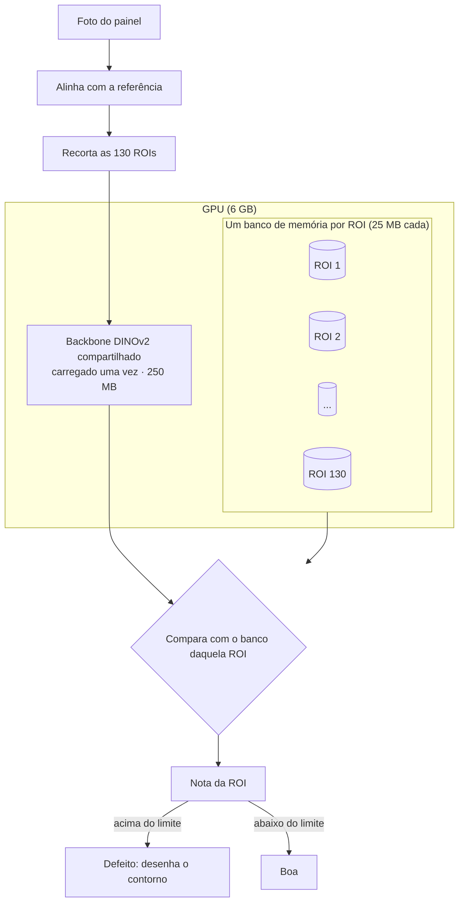

No código, isso ficou em duas partes principais: uma que carrega o backbone uma vez e empresta para todo mundo ([`backbone.py`](src/pcbad/backbone.py)), e outra que representa o modelo de cada ROI, guardando só o banco de memória e o limiar ([`patchcore.py`](src/pcbad/patchcore.py)). O cálculo da nota continua sendo o do próprio anomalib.

### 2.5 Parâmetros e por que escolhi cada um

Cada número da configuração tem uma história:

| Parâmetro | Valor | Por quê |
|---|---|---|
| Backbone | DINOv2 ViT-B (versão base) | nas mesmas 17 fotos de produção, a folga entre o curto real e a ROI boa mais "estranha" foi de 11% com a WideResNet-50 para 50% com o DINOv2. Com 11% quase não sobra espaço para colocar o limiar. O custo é tempo: de 19 para 91 ms por ROI. No VisA o resultado foi o contrário, e eu conto isso na seção [3.5](#35-pcbs-públicas-visa). |
| Camada | bloco 8 de 12 | um bloco do meio da rede, que enxerga forma sem perder o detalhe local. O teste de camadas no VisA (seção [3.5](#35-pcbs-públicas-visa)) me fez repensar essa escolha. |
| Tamanho da ROI e da entrada | ROI de 512 px, entrada de 518 px | o DINOv2 trabalha com quadradinhos de 14 px, então a entrada precisa ser múltipla de 14, e 518 é a mais perto de 512. A ROI é ampliada só um pouquinho e não perde resolução. Cada quadradinho cobre uns 0,6 mm de placa, e um curto tem 1 mm ou mais. |
| Quanto guardar no banco (coreset) | 10% dos vetores, diminuindo aos poucos com mais fotos, nunca abaixo de 1% | guardando 50%, os 130 modelos precisariam de 10,6 GB; com 10%, uns 2 GB. O próprio artigo do PatchCore usa 1% e chega no mesmo resultado do banco completo. Do jeito que deixei, dobrar as fotos aumenta o banco em 41%, e não em 100% (Figura 8). |
| Vizinhos usados na nota | 9 | é o padrão do artigo e do anomalib. Funcionou bem, então deixei, e o teste no VisA confirmou que 9 está entre os melhores valores. |
| Limiar | calculado só com fotos boas | explico na seção [2.6](#26-limiar-sem-nenhuma-amostra-com-defeito) |
| Margem de sensibilidade | 1,15 | o limite final é o limiar calculado mais 15%. É um chorinho a mais para a estação não ficar dando falso defeito à toa por uma variação pequena de luz ou de posição, e defeito de verdade continua acima disso. |
| Semente | 42 | a escolha do coreset começa num ponto aleatório. Com a semente fixa, retreinar com as mesmas fotos dá exatamente o mesmo limiar (deu 22,082272 nas duas vezes). Com outras sementes ele varia uns 5%. |
| Contorno do defeito | metade do pico do mapa de calor | assim um defeito pequeno ganha um contorno pequeno e um defeito grande ganha um contorno grande. Escolhi amarelo e magenta porque continuam fáceis de distinguir para quem é daltônico. |

<p align="center">
  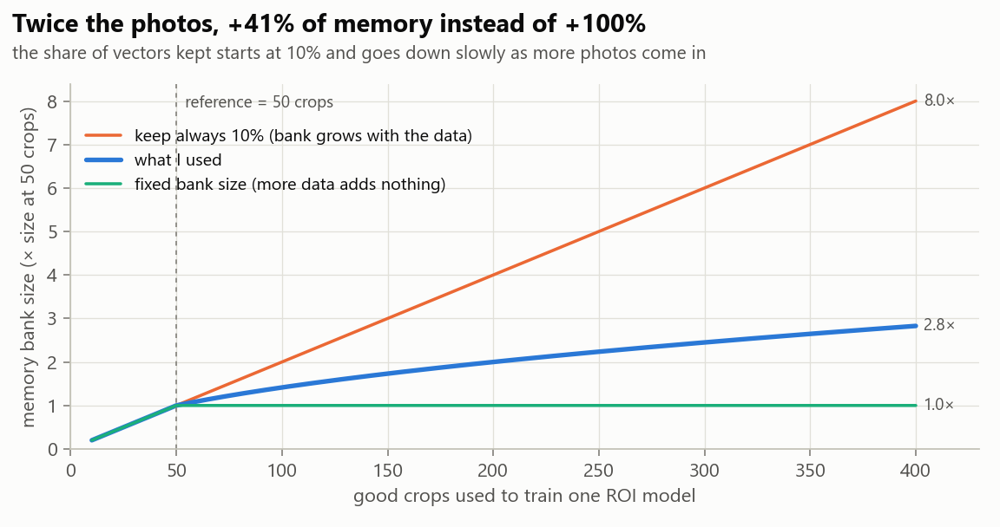<br>
  <i>Figura 8. Tamanho do banco de memória conforme o número de fotos de treino cresce.</i>
</p>

E por que não guardar o banco inteiro? Porque cinquenta fotos da mesma jiga, com a mesma luz, dão quadradinhos quase iguais em cada posição, e a maior parte da ROI é máscara verde lisa. Mesmo guardando 10%, o banco ainda fica com uns 8 600 vetores. No fim, o que pesa de verdade é a variedade das fotos, muito mais do que o tamanho do banco.

### 2.6 Limiar sem nenhuma amostra com defeito

Para definir um limiar de reprovação, normalmente você precisa de exemplos com defeito. Eu não tenho nenhum na hora do treino, então o limiar tem que sair das próprias fotos boas.

No começo eu usava o padrão do anomalib, e foi aí que percebi o problema do sorteio que contei acima. Troquei por isto:

1. Todas as fotos boas entram no banco de memória.
2. Depois, cada foto recebe uma nota como se fosse uma peça nova, usando o banco sem os pedaços que vieram dela mesma (a técnica é conhecida como "deixa um de fora", ou *leave-one-out*).
3. O limiar fica num ponto que deixa 90% dessas notas abaixo dele. Assim, se uma ou outra foto estranha (um defeito que escapou para o treino, por exemplo) tiver nota alta, ela não puxa o limiar para cima.
4. Em cima disso entra a margem de 1,15.

Fiquei com medo de esse atalho (tirar os pedaços da foto em vez de treinar de novo sem ela) não valer, então comparei com um retreino de verdade em 78 fotos de produção. Bateu: a diferença ficou entre 0,1% e 4%. A comparação também mostrou por que não dá para avaliar a foto com ela mesma no banco: uma foto estranha tirou 15,5 assim e 39,9 sem ela. Justamente a foto que eu queria achar ficava escondida.

No VisA essa calibração fez o que devia nas placas boas: com a margem de 1,15, o falso defeito em placa boa nunca vista ficou entre 0 e 7%. O preço é deixar passar mais defeitos. Com a configuração de produção, ela pegou só de 7 a 17% das placas com defeito; sem a margem, pegou de 30 a 41%, com 4 a 14% de falso defeito. A margem é justamente o botão que troca uma coisa pela outra.

<p align="center">
  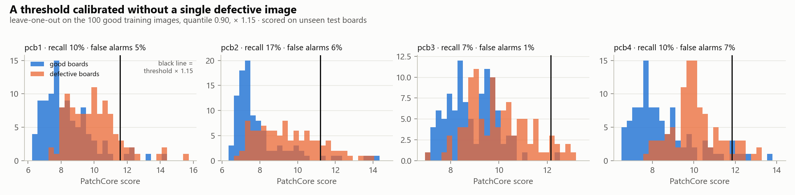<br>
  <i>Figura 9. VisA, DINOv2 ViT-B bloco 8: notas de placas boas e com defeito nunca vistas, e a linha do limite. O limite saiu só das fotos boas de treino.</i>
</p>

---

## 3. Resultados

Antes dos detalhes, um resumo do que eu medi:

| Pergunta | Resposta | Onde |
|---|---|---|
| Compartilhar o backbone muda as notas? | praticamente não, diferença de 0,001% | [3.1](#31-compartilhar-o-backbone-não-muda-o-resultado) |
| Quanto de VRAM economiza? | 89,9% com 130 ROIs e DINOv2 ViT-B (de 35,0 GB para 3,54 GB) | [3.2](#32-memória) |
| Quanto tempo leva para carregar um modelo de ROI? | 18 ms de um arquivo de 25 MB, contra 1,5 s de um de 275 MB | [3.3](#33-tempo-de-carga-e-tamanho-dos-arquivos) |
| O DINOv2 é melhor que a WideResNet? | na placa de produção sim, no VisA não | [3.4](#34-backbone-nos-painéis-de-produção), [3.5](#35-pcbs-públicas-visa) |
| Qual camada do DINOv2 funciona melhor no VisA? | o bloco 2 (0,933); o bloco 8, usado em produção, foi o pior dos quatro | [3.5](#qual-camada-do-dinov2) |
| Guardar só 1% dos vetores piora alguma coisa? | não, 0,812 contra 0,789 com o banco inteiro | [3.5](#os-outros-parâmetros) |

Todos os números de memória e tempo foram medidos no meu notebook:

| | |
|---|---|
| GPU | NVIDIA RTX 1000 Ada Generation Laptop GPU, 6 GB |
| Software | PyTorch 2.5.1, anomalib 2.2.0, timm 1.0.24 |
| Tamanho dos bancos | o de 80 fotos de treino por ROI |

### 3.1 Compartilhar o backbone não muda o resultado

Essa era a primeira coisa que eu precisava provar, senão o resto não valia nada. Comparei o meu modelo com backbone compartilhado contra o modelo original do anomalib, com o mesmo banco de memória:

| Verificação | DINOv2 ViT-B | WideResNet-50 |
|---|---|---|
| Diferença na nota da imagem | 0,001% | 0 |
| Diferença no mapa de calor | desprezível (0,002 numa escala de 0 a 8) | desprezível (0,005 numa escala de 0 a 16) |
| Diferença nos pesos do backbone | nenhuma | nenhuma |

A diferencinha na nota vem da otimização de velocidade do DINO que eu liguei, e a do mapa vem da suavização mais rápida. Nenhuma placa muda de aprovada para reprovada por causa disso.

### 3.2 Memória

VRAM ocupada com 130 modelos de ROI carregados:

| Backbone | Tamanho do backbone | Tamanho de um banco | 130 ROIs, um modelo completo cada | 130 ROIs, backbone compartilhado | Economia |
|---|---|---|---|---|---|
| WideResNet-50 | 15,8 MB | 19,8 MB | 4,55 GB (medido) | 2,55 GB | −43,8% |
| DINOv2 ViT-S | 64,8 MB | 12,7 MB | 9,72 GB (estimado) | 1,67 GB | −82,8% |
| DINOv2 ViT-B | 250,0 MB | 25,4 MB | 34,99 GB (estimado) | 3,54 GB | −89,9% |

"Estimado" quer dizer que aquela configuração não cabe na GPU e eu não tinha como rodar. O valor é o custo medido de um modelo multiplicado pelo número de modelos, e os pontos que deu para medir caem certinho nessa reta (Figura 6).

Na prática, nessa GPU de 6 GB cabem uns 18 modelos DINOv2 ViT-B completos. Com o backbone compartilhado cabem uns 190, então qualquer uma das placas, com 110 a 120 ROIs, entra com folga.

O tempo por ROI não muda conforme os modelos entram: uns 90 ms com o backbone compartilhado. Compartilhar mexe só na memória.

### 3.3 Tempo de carga e tamanho dos arquivos

Quanto tempo leva para carregar um modelo de ROI do disco, com o backbone compartilhado já carregado:

| Backbone | Arquivo padrão do anomalib | Arquivo só com o banco |
|---|---|---|
| WideResNet-50 | 35,6 MB, 0,98 s | 19,8 MB, 0,009 s |
| DINOv2 ViT-S | 76,6 MB, 0,36 s | 12,7 MB, 0,006 s |
| DINOv2 ViT-B | 274,6 MB, 1,54 s | 25,4 MB, 0,018 s |

Num painel de 130 ROIs com ViT-B, isso é a diferença entre esperar uns 3 minutos e esperar 2 segundos para a estação ficar pronta.

### 3.4 Backbone nos painéis de produção

Esse teste eu fiz antes, no servidor de produção, e foi ele que me fez trocar para o DINOv2: uma placa, 17 fotos, um curto real.

| | WideResNet-50 | DINOv2 ViT-B |
|---|---|---|
| Nota do curto real | 1,027 | 1,356 |
| Maior nota entre as ROIs boas | 0,924 | 0,906 |
| Folga entre o curto e a pior ROI boa | 11% | 50% |
| Tempo por ROI | 19 ms | 91 ms |

Com a WideResNet o curto ficava só 11% acima da pior ROI boa, e qualquer variação pequena virava defeito perdido ou falso defeito. Com o DINOv2 essa folga foi para 50%. Depois testei também o ViT-S, a versão menor do DINOv2, nas 7 ROIs mais difíceis da Placa C: foi mais rápido (41 ms por ROI) e detectou parecido.

Olhando hoje, essa comparação foi pequena: uma placa e um curto real. E os resultados do VisA logo abaixo não concordam com ela. Volto nisso nas conclusões.

### 3.5 PCBs públicas (VisA)

Como não posso publicar as fotos de produção, rodei o mesmo código nas quatro categorias de PCB do VisA [6]. Usei 100 fotos boas de treino por categoria (perto das ~80 por ROI que uso na linha) e umas 200 fotos de teste por categoria, metade boa e metade com defeito. Cada placa foi tratada como uma região só. Tudo aqui sai do [`scripts/eval_visa.py`](scripts/eval_visa.py), que levou umas 2 horas no notebook. Como usei só 100 fotos de treino (o dataset completo tem umas 900 por categoria), esses números servem para comparar as configurações entre si, e não com os resultados publicados por outros trabalhos.

A métrica principal aqui é o AUROC, que vai de 0,5 (chute) a 1,0 (perfeito) e mede o quanto o modelo separa as placas boas das placas com defeito.

<p align="center">
  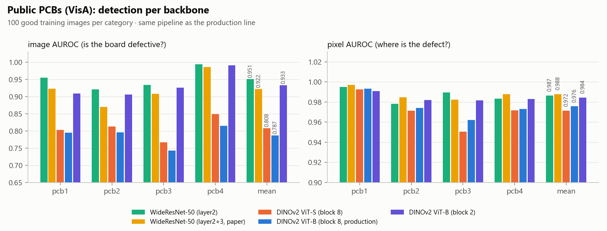<br>
  <i>Figura 10. AUROC de imagem (a placa tem defeito?) e AUROC de pixel (onde está o defeito?) por backbone no VisA.</i>
</p>

| Configuração | AUROC de imagem (média das 4) | AUROC de pixel | Defeitos pegos com margem 1,15 | Falso defeito com margem 1,15 |
|---|---|---|---|---|
| WideResNet-50 | 0,951 | 0,987 | 54–91% | 1–4% |
| WideResNet-50, configuração do artigo original | 0,922 | 0,988 | 32–94% | 0–6% |
| DINOv2 ViT-S, bloco 8 | 0,808 | 0,972 | 8–23% | 0–7% |
| DINOv2 ViT-B, bloco 8 (configuração de produção) | 0,787 | 0,976 | 7–17% | 1–7% |
| DINOv2 ViT-B, bloco 8, com distância cosseno | 0,891 | 0,985 | 21–49% | 1–5% |
| DINOv2 ViT-B, bloco 2 | 0,933 | 0,984 | 30–65% | 0–1% |

Confesso que esse resultado me pegou de surpresa. Nessas placas a configuração de produção foi a mais fraca para dizer se a placa tem defeito, e a WideResNet-50 foi a melhor. Já para mostrar onde está o defeito (AUROC de pixel), todas ficaram parecidas, entre 0,97 e 0,99.

Minha primeira suspeita foi erro meu, então fui conferir a forma como as features do DINO são extraídas. Estava tudo certo. O que ajudou foi trocar a forma de medir a distância entre os pedaços por uma distância cosseno, como faz o AnomalyDINO [2]: isso sozinho levou o bloco 8 de 0,787 para 0,891.

<p align="center">
  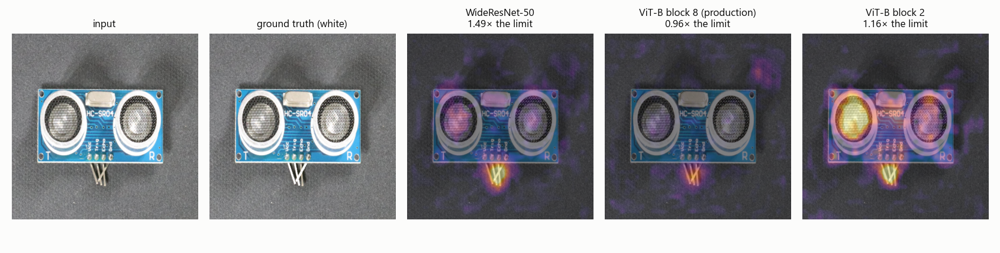<br>
  <i>Figura 11. A mesma placa com defeito vista por cada backbone. O número embaixo é a nota dividida pelo limite (1,00 ou mais reprova).</i>
</p>

Por que isso não bate com o teste de produção da seção 3.4, em que o DINOv2 deu mais folga? Os dois testes não olham o mesmo tipo de defeito. O VisA tem componente faltando, risco e peça derretida em módulos pequenos (sensores e carregadores) fotografados sobre um fundo liso, e a linha tem solda, com iluminação fixa. E o teste de produção também foi pequeno. A leitura que eu faço é que o backbone precisa ser validado para cada produto, e por isso no código ele é só uma opção de configuração.

#### Qual camada do DINOv2

O DINOv2 tem 12 blocos, e dá para tirar as features de qualquer um deles. Testei quatro:

<p align="center">
  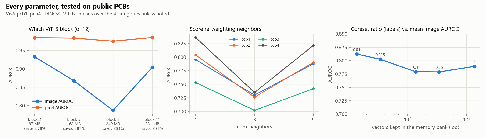<br>
  <i>Figura 12. À esquerda, AUROC conforme o bloco do DINOv2 de onde saem as features, com o tamanho do backbone em cada caso. No meio, o número de vizinhos usado na nota. À direita, quanto do banco é guardado contra o AUROC.</i>
</p>

| Bloco do DINOv2 ViT-B | AUROC de imagem | AUROC de pixel | Tamanho do backbone | Economia máxima de VRAM |
|---|---|---|---|---|
| 2 | 0,933 | 0,984 | 87 MB | 78% |
| 5 | 0,868 | 0,983 | 168 MB | 87% |
| 8 (produção) | 0,787 | 0,975 | 249 MB | 91% |
| 11 | 0,904 | 0,985 | 331 MB | 93% |

O bloco 8, que eu uso em produção, ficou bem no fundo. Antes de acreditar, quis ter certeza de que a diferença entre o bloco 2 e o bloco 8 não era sorte, então fiz um teste estatístico simples (bootstrap, com o [`scripts/bootstrap_ci.py`](scripts/bootstrap_ci.py)). A vantagem do bloco 2 se manteve nas quatro categorias, com margem de segurança. Treinando o bloco 2 de novo do zero, o resultado mudou menos de 0,01.

Um bloco mais no começo da rede também deixa o backbone menor, então o bloco 2 seria mais rápido e gastaria menos VRAM, mesmo economizando um pouco menos no compartilhamento (78% em vez de 91%). Ainda não testei o bloco 2 nas soldas, mas é a primeira coisa que quero testar na linha.

#### Os outros parâmetros

- Vizinhos usados na nota: 1 e 9 dão quase o mesmo resultado, e 3 foi pior nas quatro categorias, o que eu não sei explicar. Mantive 9.
- Tamanho do banco: guardar só 1% dos vetores deu 0,812, e o banco inteiro (100 vezes maior) deu 0,789. Nessas placas, guardar menos não piorou nada, como o artigo do PatchCore promete.

#### As duas primeiras tentativas com dados públicos

<p align="center">
  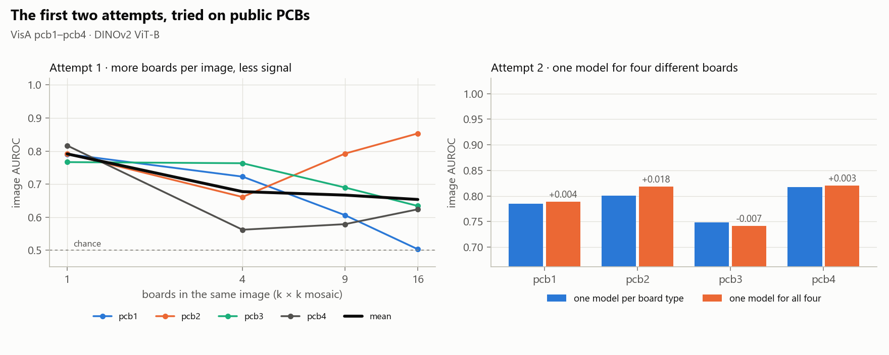<br>
  <i>Figura 13. À esquerda, cada placa de teste colocada no meio de outras placas boas, para imitar um painel. À direita, um modelo treinado com os quatro tipos de placa juntos contra um modelo por tipo.</i>
</p>

Para imitar a tentativa 1, coloquei cada placa no meio de outras placas boas (4, 9 e 16 placas por imagem) e treinei e testei assim. O AUROC médio caiu de 0,791 com a placa sozinha para 0,677, 0,667 e 0,654. No pcb1 chegou a 0,503, que é o mesmo que chutar. O pcb2 foi para o outro lado, e ainda não tenho uma explicação para isso.

Para a tentativa 2, treinei um modelo só com os quatro tipos de placa juntos, e o resultado praticamente não mudou. No começo achei estranho, mas faz sentido com o que contei na seção 2.3: o modelo único só quebra quando a mesma coisa é normal num lugar e defeito em outro, como nos curtos propositais da linha. O VisA não tem esse caso, então esse teste não tinha como reproduzir aquela falha.

#### Exemplos

<p align="center">
  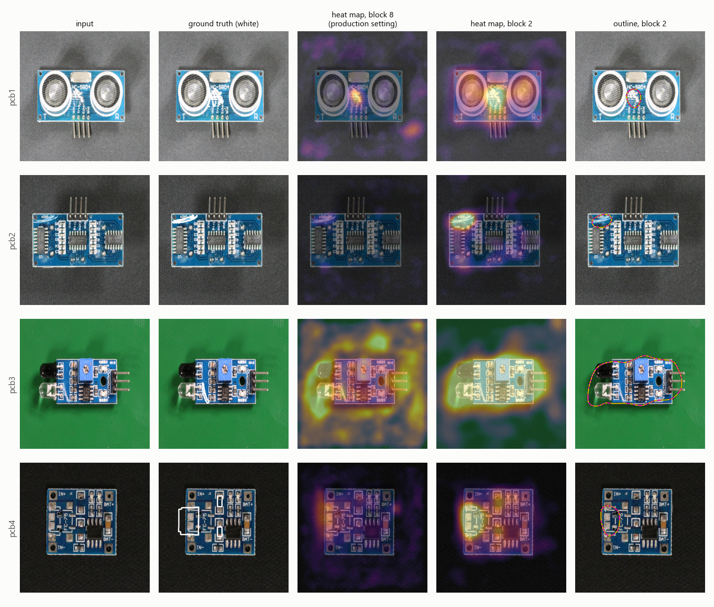<br>
  <i>Figura 14. Uma placa com defeito por categoria: a foto, o defeito marcado no gabarito, o mapa de calor do bloco 8 (produção), o do bloco 2 e o contorno desenhado a partir do bloco 2.</i>
</p>

<p align="center">
  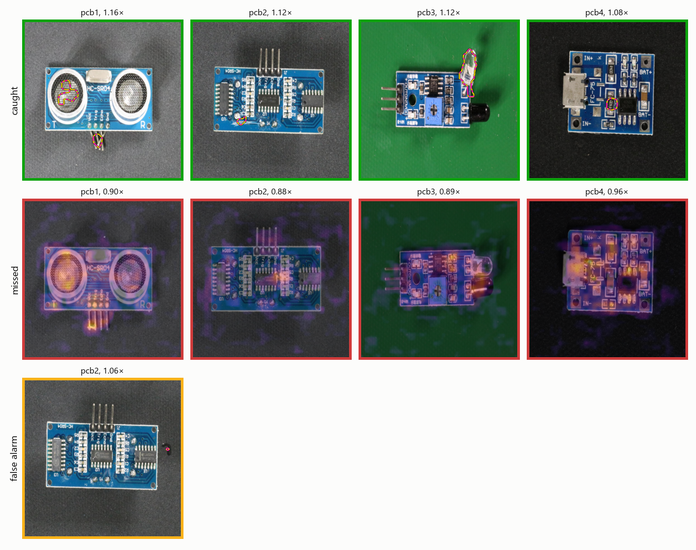<br>
  <i>Figura 15. Com o bloco 2 e margem 1,15: placas com defeito que o sistema pegou (contorno amarelo e magenta), placas com defeito que passaram (mapa de calor) e placas boas que ele reprovou. O número é a nota dividida pelo limite. O único falso defeito das quatro categorias foi um grãozinho no fundo, fora da placa: o mesmo "marca o que é novo, não o que importa" que acontece com os riscos na linha.</i>
</p>

### 3.6 Na linha de produção

Estas medições foram feitas no servidor de produção, antes deste repositório existir. A maior delas aplica um filtro de solda (conto mais nos próximos passos) em todas as reprovações antigas que ainda tinham a foto original: 163 ROIs das três placas, cada uma avaliada de novo pelo modelo atual.

| Placa | Reprovadas na época | Aprovam com o modelo de hoje | Descartadas pelo filtro de solda | Continuam reprovando |
|---|---|---|---|---|
| A | 64 | 32 | 0 | 32 |
| B | 45 | 0 | 25 | 20 |
| C | 54 | 0 | 40 | 14 |

Conferi as 65 descartadas uma por uma: máscara lisa, etiqueta, furo de fixação, nenhuma em cima de solda. Os curtos conhecidos continuaram reprovando. Num job da Placa C, as reprovações caíram de 11 (1 curto e 10 riscos) para 3. E metade das reprovações antigas da Placa A já passa com o modelo de hoje, antes de qualquer filtro.

Nas 7 ROIs mais difíceis da Placa C, com defeitos simulados, o DINOv2 ViT-S pegou 13 de 20 faltas de solda e 3 de 20 bolinhas de solda. Bolinha de solda é pequena, e com a margem de 1,15 o modelo deixa passar a maioria.

O que ainda falta é um conjunto de teste da linha com os defeitos marcados, para medir quantos defeitos o sistema pega e quantos falsos defeitos ele dá em cada placa, como fiz para o VisA na seção 3.5.

---

## 4. Conclusões

O PatchCore com um modelo por ROI acha defeito de solda usando só painel bom, e é exatamente isso que o torna utilizável numa linha em que defeito é raro. Olhando para trás, as tentativas que falharam foram as que mais me ensinaram. O modelo do painel inteiro mostrou que resolução vem antes de tudo. O modelo único mostrou que posição importa, pelo menos em placa com curto proposital e pad vazio: cada ROI precisa da sua própria ideia de normal.

A contribuição principal veio quando percebi que esse desenho por ROI gastava quase toda a memória com cópias iguais da mesma rede. Compartilhando um backbone e guardando só os bancos de memória por ROI:

- as notas continuam praticamente as mesmas do anomalib;
- a VRAM cai 90% com o DINOv2 ViT-B, de 35 GB para 3,5 GB com 130 ROIs, que na prática é a diferença entre não rodar e rodar numa GPU de notebook de 6 GB;
- cada modelo vira um arquivo de 25 MB que carrega em 18 ms.

E quanto maior o backbone, maior a economia: uns 44% com a WideResNet-50 e uns 90% com o DINOv2 ViT-B.

O teste no VisA foi a surpresa mais útil do trabalho. Nessas placas a configuração de produção (DINOv2 ViT-B no bloco 8) foi a mais fraca das que testei, e o bloco 2 da mesma rede ou a WideResNet-50 separaram muito melhor placa boa de placa com defeito. Só trocar a forma de medir a distância já levou o bloco 8 de 0,787 para 0,891. Nas soldas da linha o DINOv2 tinha dado mais folga, mas aquela comparação usou uma placa e um curto real. Saio disso com duas certezas: backbone e camada precisam ser conferidos em cada produto, e a arquitetura deixa essa conferência barata, porque os dois são só opções de configuração e a economia de VRAM vale para qualquer um deles.

#### Limitações

- O PatchCore marca o que é novo, e isso nem sempre é o que importa. Para ele, um risco ou um grão de poeira é tão estranho quanto um curto: num job de produção, 10 das 11 ROIs reprovadas eram riscos e só 1 era curto de verdade.
- Ele depende de câmera e jiga fixas. Se o painel se mexer é preciso alinhar a foto, e se a luz ou a câmera mudarem é preciso treinar de novo.
- As configurações com um modelo completo por ROI que não cabem na GPU foram estimadas, não medidas. Os pontos que deu para medir batem com a estimativa, mas os valores maiores são extrapolação.
- As fotos de treino precisam ser conferidas: um painel com defeito que entra no treino ensina ao modelo que aquele defeito é normal.
- Ainda não tenho um conjunto de teste da linha com os defeitos marcados, então a detecção em produção aparece pela comparação da seção 3.4 e pelas reprovações reavaliadas da seção 3.6.

#### Próximos passos

- Testar o bloco 2 do DINOv2, a distância cosseno e a WideResNet-50 nas soldas, com um conjunto de teste da linha.
- Trazer para este repositório o filtro de solda que já roda em produção e ficou fora do escopo aqui. Ele ignora anomalias que caem longe de qualquer solda: em 163 reprovações antigas de três placas, descartou 65, todas conferidas uma a uma como riscos e manchas, e os curtos conhecidos continuaram reprovando.
- Diminuir ainda mais os bancos de memória para baixar a VRAM.
- Processar todas as ROIs de um painel de uma vez só, em vez de uma por uma, para o painel sair mais rápido.

---

## 5. Perguntas frequentes

<details>
<summary><b>Por que não YOLO ou outro detector supervisionado?</b></summary>

Porque eu precisaria de centenas de exemplos rotulados de cada tipo de defeito, e aqui defeito é raro e muda o tempo todo. O PatchCore só precisa de painel bom e ainda pega defeito que ninguém tinha listado antes. O lado ruim é que ele marca qualquer coisa nova, risco incluso (ver Limitações).
</details>

<details>
<summary><b>Compartilhar o backbone muda a detecção?</b></summary>

Não. O backbone é o mesmo em todos os modelos, e as notas batem com o anomalib original com diferença de 0,001% (seção 3.1).
</details>

<details>
<summary><b>Por que DINOv2 e não a WideResNet-50 do artigo?</b></summary>

Nos painéis reais o DINOv2 abriu a folga entre um curto real e a pior ROI boa de 11% para 50%, e o limiar deixou de ficar tão no fio da navalha. Backbone maior também faz o compartilhamento render mais, uns 90% em vez de 44%. Só que no VisA a WideResNet foi melhor (seção 3.5), então essa é uma escolha para conferir em cada produto. No código o backbone é só uma opção de configuração.
</details>

<details>
<summary><b>Quantas fotos boas uma ROI nova precisa?</b></summary>

O código recusa menos de 5. Na linha, de 50 a 80 painéis por ROI funcionou bem. Variedade conta mais que quantidade: 50 painéis diferentes valem mais que 200 fotos do mesmo painel, porque o modelo precisa aprender como os painéis bons variam entre si.
</details>

<details>
<summary><b>E se um painel com defeito entrar no treino?</b></summary>

O modelo aprende aquele defeito como normal para a ROI e vai aprovar. O jeito de calcular o limiar impede que uma ou duas fotos ruins subam o limite para todos os outros defeitos, mas não desaprende o que entrou. Vale sempre dar uma olhada nas fotos de treino.
</details>

<details>
<summary><b>Precisa de GPU?</b></summary>

Não, roda na CPU também, só que bem mais devagar. A graça de compartilhar o backbone é justamente que uma GPU de notebook de 6 GB dá conta do painel inteiro.
</details>

<details>
<summary><b>Glossário</b></summary>

| Termo | O que quer dizer aqui |
|---|---|
| ROI | região de interesse, um recorte de 512 × 512 px do painel em volta de um grupo de soldas |
| Backbone | rede já treinada que transforma a imagem em números; aqui ela nunca é treinada de novo |
| Banco de memória | os pedaços das fotos boas que cada modelo de ROI guarda para comparar |
| Coreset | a escolha de quais pedaços guardar no banco, ficando com os mais diferentes entre si |
| Nota | o quanto o pedaço mais estranho da foto está longe do pedaço bom mais parecido; 1,0 ou mais (depois de dividir pelo limite) é defeito |
| Limiar, margem | o limite calculado para a nota e os 15% de folga por cima dele |
| AUROC | métrica de 0,5 (chute) a 1,0 (perfeito) que mede o quanto o modelo separa placas boas de placas com defeito |
| VRAM | memória da placa de vídeo (GPU) |
</details>

---

## 6. Como executar

**1. Ambiente** (Python 3.10, GPU NVIDIA recomendada)

```bash
python -m venv .venv
.venv\Scripts\activate            # Linux/macOS: source .venv/bin/activate
pip install -r requirements.txt --extra-index-url https://download.pytorch.org/whl/cu121
```

Os pesos do DINOv2 (uns 350 MB) baixam sozinhos na primeira vez.

**2. Teste rápido numa PCB pública** (VisA)

Se você só quer ver o sistema funcionando, esse é o caminho mais curto:

```bash
mkdir -p data/visa && cd data/visa
curl -LO https://amazon-visual-anomaly.s3.us-west-2.amazonaws.com/VisA_20220922.tar     # 1,9 GB
mkdir VisA && tar -xf VisA_20220922.tar -C VisA --wildcards "pcb*/*"
curl -LO https://raw.githubusercontent.com/amazon-science/spot-diff/main/split_csv/1cls.csv
cd ../..

python scripts/prepare_visa_demo.py --visa data/visa/VisA --split data/visa/1cls.csv --category pcb1
python scripts/train.py --board data/visa_demo/pcb1 --out models/visa_pcb1
python scripts/infer.py --models models/visa_pcb1 --images data/visa_demo/pcb1/test --out outputs/visa_pcb1
```

**3. Reproduzir os números deste README**

| Comando | O que gera | Tempo no meu notebook |
|---|---|---|
| `python scripts/check_equivalence.py --backbone dinov2_vitb14` | seção 3.1 | menos de 1 min |
| `python scripts/benchmark_vram.py` | seções 3.2 e 3.3, Figuras 6 e 7 | uns 15 min |
| `python scripts/eval_visa.py --visa data/visa/VisA --split data/visa/1cls.csv` | seção 3.5 | umas 3 h |
| `python scripts/make_figures.py` | Figuras 6 a 8, figura geral, animação de VRAM | segundos |
| `python scripts/visa_layer_examples.py --visa data/visa/VisA --split data/visa/1cls.csv` | mapas do bloco 2 da Figura 14 | uns 10 min |
| `python scripts/bootstrap_ci.py --visa data/visa/VisA --split data/visa/1cls.csv` | teste estatístico da seção 3.5 | menos de 1 min |
| `python scripts/make_visa_figures.py --visa data/visa/VisA --split data/visa/1cls.csv` | gráficos do VisA | menos de 1 min |
| `python scripts/make_visa_photo_figures.py --visa data/visa/VisA --split data/visa/1cls.csv` | Figuras 4, 11 e 15 | uns 15 min |

**4. Interface web** (treinar, ajustar a margem, inspecionar e ver a VRAM em uso)

Também fiz uma interface simples para quem não quer usar a linha de comando:

```bash
pip install gradio==5.9.1 pydantic==2.10.6
python app/demo.py          # http://127.0.0.1:7860
```

<p align="center">
  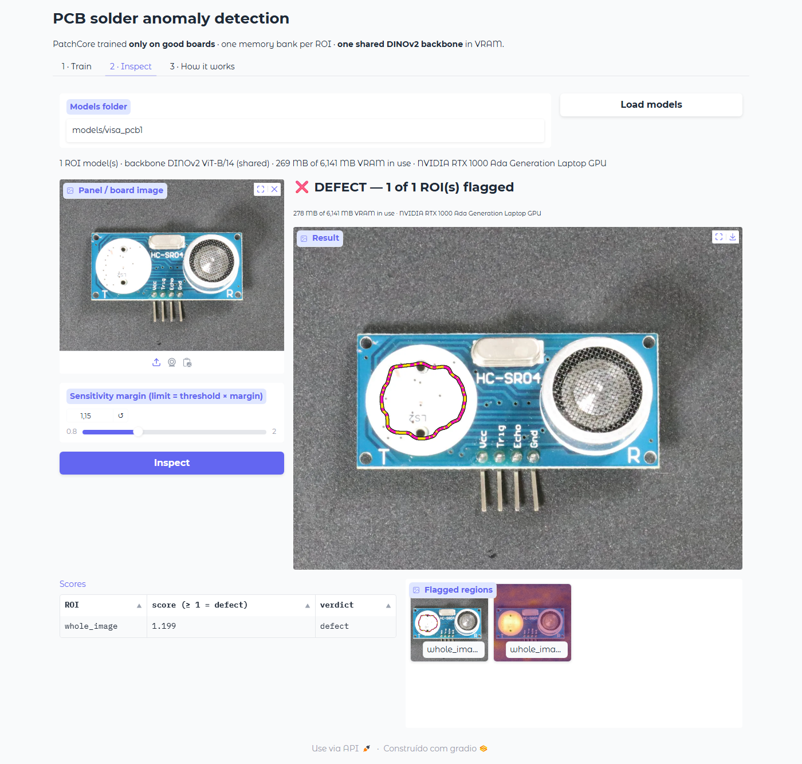<br>
  <i>Figura 16. A interface inspecionando uma placa do VisA: veredito, contorno, mapa de calor e VRAM em uso.</i>
</p>

**5. Treinar nas suas placas.** Organize as fotos como em [data/README.md](data/README.md) e rode:

```bash
python scripts/train.py --board data/board_a --out models/board_a
```

Ele treina um modelo por ROI, mostra o limiar de cada uma e salva tudo na pasta de saída.

**6. Inspecionar painéis**

```bash
python scripts/infer.py --models models/board_a --images data/board_a/test --out outputs/board_a --margin 1.15
```

Para cada painel sai uma imagem com cada ROI num quadro verde ou vermelho e os defeitos contornados, e um arquivo com a nota e o veredito de cada ROI.

<p align="center">
  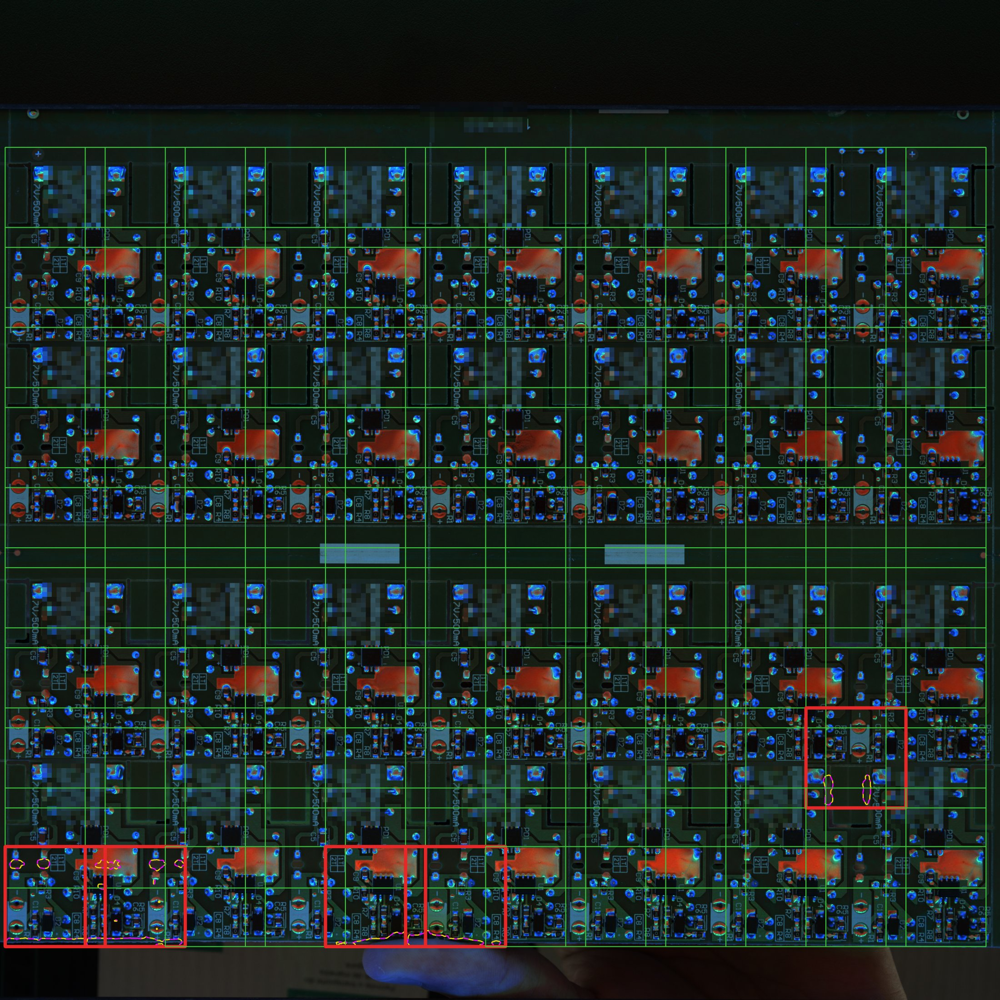<br>
  <i>Figura 17. Uma inspeção real da Placa D feita pelo sistema de produção: as ROIs aprovadas em verde e as 5 reprovadas em vermelho, com o contorno que o sistema desenhou. Quatro delas ficam na borda de baixo, onde aparece a mão de quem segurava o painel na hora da foto. O modelo nunca tinha visto uma mão ali, então marcou como anomalia, que é exatamente o "marca o que é novo" das limitações.</i>
</p>

---

## 7. Estrutura do repositório

```
├── README.md / README_pt.md
├── CITATION.cff
├── requirements.txt
├── src/pcbad/
│   ├── backbone.py            carrega o backbone uma vez e empresta para todos os modelos
│   ├── patchcore.py           o modelo de cada ROI: banco de memória e limiar
│   ├── coreset.py             quanto guardar no banco de memória
│   ├── pipeline.py            treina uma placa e inspeciona uma imagem
│   ├── data.py                organização das fotos e recorte das ROIs
│   └── visualize.py           contorno do defeito e mapa de calor
├── scripts/
│   ├── train.py               treina um modelo por ROI
│   ├── infer.py               inspeciona painéis
│   ├── check_equivalence.py   confere que o backbone compartilhado dá as mesmas notas
│   ├── benchmark_vram.py      mede VRAM, tempo de carga e velocidade
│   ├── eval_visa.py           todos os experimentos no VisA
│   ├── prepare_visa_demo.py   prepara uma pastinha do VisA pronta para treinar
│   ├── make_figures.py        gráficos de memória, figura geral e animação
│   ├── make_visa_figures.py   gráficos do VisA
│   ├── make_visa_photo_figures.py  figuras com imagens do VisA
│   ├── visa_layer_examples.py mapas de calor do bloco 2
│   ├── bootstrap_ci.py        teste estatístico bloco 2 vs bloco 8
│   ├── make_photo_figures.py  gera as figuras com foto real a partir das fotos de produção
│   └── hide_logo.py           esconde o logo e o código do produto em todas as placas da foto
├── app/demo.py                interface web
├── results/                   resultados gravados pelos scripts
├── assets/figures/            gráficos e figuras
├── assets/photos/             fotos reais dos painéis (sem logo)
└── data/README.md             como organizar as suas fotos
```

Este repositório é uma versão limpa do núcleo de inspeção de um sistema interno bem maior. A plataforma web, o controle de câmera, a integração com o CLP e o painel do operador ficaram de fora.

---

## 8. Referências

1. K. Roth, L. Pemula, J. Zepeda, B. Schölkopf, T. Brox, P. Gehler. *Towards Total Recall in Industrial Anomaly Detection.* CVPR 2022. [arXiv:2106.08265](https://arxiv.org/abs/2106.08265)
2. S. Damm, M. Laszkiewicz, J. Lederer, A. Fischer. *AnomalyDINO: Boosting Patch-based Few-shot Anomaly Detection with DINOv2.* WACV 2025. [arXiv:2405.14529](https://arxiv.org/abs/2405.14529)
3. M. Oquab et al. *DINOv2: Learning Robust Visual Features without Supervision.* TMLR 2024. [arXiv:2304.07193](https://arxiv.org/abs/2304.07193)
4. T. Darcet, M. Oquab, J. Mairal, P. Bojanowski. *Vision Transformers Need Registers.* ICLR 2024. [arXiv:2309.16588](https://arxiv.org/abs/2309.16588)
5. S. Akcay et al. *Anomalib: A Deep Learning Library for Anomaly Detection.* ICIP 2022. [arXiv:2202.08341](https://arxiv.org/abs/2202.08341)
6. Y. Zou, J. Jeong, L. Pemula, D. Zhang, O. Dabeer. *SPot-the-Difference Self-Supervised Pre-training for Anomaly Detection and Segmentation (VisA).* ECCV 2022. [arXiv:2207.14315](https://arxiv.org/abs/2207.14315)
7. P. Bergmann, M. Fauser, D. Sattlegger, C. Steger. *MVTec AD – A Comprehensive Real-World Dataset for Unsupervised Anomaly Detection.* CVPR 2019.
8. O. Sener, S. Savarese. *Active Learning for Convolutional Neural Networks: A Core-Set Approach.* ICLR 2018. [arXiv:1708.00489](https://arxiv.org/abs/1708.00489)
9. T. Defard, A. Setkov, A. Loesch, R. Audigier. *PaDiM: a Patch Distribution Modeling Framework for Anomaly Detection and Localization.* ICPR Workshops 2020. [arXiv:2011.08785](https://arxiv.org/abs/2011.08785)
10. B. Rolih, D. Ameln, A. Vaidya, S. Akcay. *Divide and Conquer: High-Resolution Industrial Anomaly Detection via Memory Efficient Tiled Ensemble.* CVPR Workshops 2024. [arXiv:2403.04932](https://arxiv.org/abs/2403.04932)

### Como citar

```bibtex
@misc{fagundes2026pcbpatchcore,
  author       = {Andrei Edio Fagundes},
  title        = {Detecção não supervisionada de defeitos de solda em PCB com PatchCore e backbone compartilhado},
  year         = {2026},
  howpublished = {Trabalho de conclusão, Visão Computacional Master (VC MASTER), ICA / PUC-Rio},
  note         = {Orientadora: Manoela Kohler}
}
```

### Agradecimentos

Obrigado à professora Manoela Kohler pela orientação, à equipe do ICA / PUC-Rio e ao pessoal da linha de produção e da engenharia de testes, que separou painel, marcou defeito e teve paciência com os falsos defeitos das primeiras versões.

---

Matrícula: 242.100.031

Pontifícia Universidade Católica do Rio de Janeiro

Curso de Pós Graduação *Visão Computacional Master*
